<!-- Generated by scripts/convert.py from https://datamall.lta.gov.sg/content/dam/datamall/datasets/LTA_DataMall_API_User_Guide.pdf
     Source SHA-256: c66b262b04d8d40e179c192cc2343b491ffd8a2fb82a36c0dfe8e37c6bf8de87. Do not edit by hand. -->


*an*

*LTA Open Data Initiative*

**API User Guide**

**& Documentation**

Version 6.11 \
30 Oct 2026

**Document Change Log**

| **Version No.** | **Change Details** | **Release Date** |
|---|---|---|
| 1.1 | First release of document, reflecting specifications for each dataset. | 04 Jun 2014 |
| 1.2 | Amended attributes for all datasets, and added the update frequency for each dataset in specification section. | 15 Jun 2014 |
| 1.3 | Inserted notes to denote fields that are new and upcoming; not yet available on the data feed. | 26 Jun 2014 |
| 1.4 | Minor revisions (typo errors). | 10 Mar 2015 |
| 1.5 | Revisions to names of datasets, and removed listing for certain attributes that are redundant at this point. | 07 Apr 2015 |
| 2.0 | Revised document for newly revamped DataMall.<ul><li>New Categorisation of Datasets</li><li>Moved Park & Ride Location, Premium Bus Service, and Carpark Rates to Static Datasets listed on MyTransport.SG.</li></ul> | 13 Apr 2015 |
| 2.1 | Corrected reference notes for Carpark Availability and ERP Rates. | 14 Apr 2015 |
| 2.2 2.2.1 | Added Bus Arrival, and Taxi Availability APIs <br>Amended Update Freqs for Bus Arrival and Taxi Availability | 19 Apr 2015 03 Jun 2015 |
| 3.0 | Bus Arrival API is now enhanced! Latest **\*beta\*** release includes:<ul><li>Additional 3<sup>rd</sup> set of ETA information</li><li>Estimated location (coordinates) of buses</li></ul>Look out for blue-highlights! | 12 Dec 2015 |
| 3.1 | **Public-Transport (Bus) Related APIs** are enhanced (version 2)!<ul><li>**Bus Services** and **Bus Routes** are now consolidated across Operators, e.g. SBST routes and SMRT routes in 1 single API</li><li>Attributes are renamed to be more meaningful</li><li>**Bus Stops** now include location (lat/long) coordinates</li></ul>Bug for Bus Arrival #VisitNumber fixed. | 08 Mar 2016 |
| 3.2 | Changes to **Traffic Related APIs**:<ul><li>URLs changed to point to version 2 of the APIs.</li><li>VCCType renamed to VehicleType (ERP Rates)</li><li>EstimatedTime renamed to EstTime (Estimated Travel Times)</li><li>RoadID renamed to EventID (Road Openings and Road Works)</li><li>ImageURL renamed to ImageLink (Traffic Images)</li><li>Band renamed to SpeedBand (Traffic Speed Bands)</li></ul> | 31 Mar 2016 |
| 3.3 | Changes to **API Response Size:**<ul><li>**Taxi Availability API** now returns 500 records per call.</li><li>**Traffic Images API** now returns 70 records per call.</li><li>Changes are reflected on Page 6, and on respective API URLs.</li></ul> | 08 Aug 2016 |
| 3.4 | Changes to API authentication – now requiring only AccountKey. | 01 Nov 2016 |
| 3.5 | Updated attribute description for location coordinates of **Bus Arrival API**. | 23 Nov 2016 |
| 3.6 | **Traffic Images API** now returns all records per call. | 14 Dec 2016 |
| 3.7 | Updated guide to making API calls, using Postman. | 05 Apr 2017 |
| 4.0 | **Bus Arrival API** is now enhanced! Latest release includes:<ul><li>New Attribute – Bus Type</li><li>Inclusion of Short Working Trip (SWT) Supplementary Services</li><li>Relegation of OriginCode and DestinationCode to vehicle level</li><li>Removal of entire response structure from API during non- operating hours</li><li>Removal of Status Attribute</li><li>Renaming of values for Load Attribute</li><li>Renaming of SubsequentBus and SubsequentBus3 subset tags</li><li>Renaming of BusStopID Parameter to BusStopCode</li><li>Removal of SST Parameter. Timestamps are now in SST by default.</li><li>Rehashed advisement on Front-End Implementation for clarity.</li></ul> | 28 Jul 2017 |
| 4.1 | Minor revisions to sample Bus Arrival API response. | 08 Sep 2017 |
| 4.2 | Announcement on Changes to **API Response Size** is reflected on Page 6. | 15 Sep 2017 |
| 4.3 | Deployment date has postponed for the increase of **API Response Size.** Please refer to Page 6 for the latest announcement. | 06 Oct 2017 |
| 4.4 | **Response Size for all APIs** (except Bus Arrival API) have been increased to 500 records per call. | 16 Oct 2017 |
| 4.5 | **Carpark Availability API** is now enhanced! Latest release includes:<ul><li>Includes HDB, LTA and URA carpark availability data</li><li>New Attribute – Lot Type, Agency</li><li>Combined Attribute: Location</li></ul>(previously Latitude and Longitude attributes) | 22 Jan 2018<br>(Soft released on <br>31 Dec 2017) |
| 4.6 | New **Train Service Alerts API** is launched! It returns detailed information on train service unavailability during scheduled operating hours, such as affected Line and Stations etc. | 19 Mar 2018 |
| 4.7 | **4 New Passenger Volume APIs** are launched! Aggregated passenger volume information such as number of trips, tap in and out by weekdays and weekends (inclusive of holidays) are returned.<ul><li>By Bus Stops</li><li>By Origin-Destination Bus Stops</li><li>By Origin-Destination Train Stations</li><li>By Train Stations</li></ul>Sample output for Train Service Alerts API has been changed to Annex C. | 17 Jul 2018 |
| 4.8 | **Traffic Speed Band API** is now enhanced! Latest release includes:<ul><li>Speeds are classified into 8 bands at 10km/h interval.</li></ul> | 21 Sep 2018 |
| 4.9 | **Bicycle Parking** is launched! This API returns the information of bicycle parking locations within a radius. | 11 Feb 2019 |
| 5.0 | **Taxi Stands** is launched! This API returns the detailed information of Taxi facility locations. | 10 Jan 2020 |
| 5.1 | **Traffic Images API** is updated! Image links will be valid for 5 mins only. **Geospatial Whole Island API** is launched! It returns the SHP files of the requested geospatial layer. <br>Added:<ul><li>**ANNEX D** (ZONE ID ATTRIBUTE TO SPECIFIC ERP GANTRY/GANTRIES FOR 2.13 ERP RATES)</li><li>**ANNEX E** (GEOSPATIAL WHOLE ISLAND LAYER ID FOR 2.23 GEOSPATIAL WHOLE ISLAND)</li></ul> | 01 Apr 2020 |
| 5.2 | **Facilities Maintenance** is launched! This API returns information on Facilities Maintenance schedule for elevators in MRT station | 28 May 2020 |
| 5.3 | **ANNEX E** is updated, Cycling Path Construction geospatial whole island layer has been removed from **Geospatial Whole Island API**. | 19 Jan 2021 |
| 5.4 | **2 New Platform Crowd Density APIs** are launched! These two APIs return real-time and forecasted platform crowdedness information for the MRT/LRT stations of a train network line. | 02 Nov 2021 |
| 5.5<br>5.5.1 | **Traffic Flow API** is launched! This API returns hourly average traffic volume.<ul><li>Added: **ANNEX F** (DESCRIPTION OF ROAD CATEGORIES FOR TRAFFIC FLOW)</li></ul>**Traffic Speed Band API** is now enhanced (version 3)! Latest release includes:<ul><li>Includes timestamp for last updated time</li><li>Split Attributes: StartLon, StartLat, EndLon, EndLat <br> (Previously Location attribute)</li></ul>Minor revisions to **Geospatial Whole Island** API response. <br>Updated guide to generate **Code Snippet** using Postman.<br>**Road Openings API** is renamed to **Planned Road Openings API.** <br>**Road Works API** is renamed to **Approved Road Works API.** <br>API endpoints remain unchanged. | 04 Apr 2023<br>15 Mar 2024 |
| 6.0 | **HTTPS is now supported for all APIs.** <br>**Bus Arrival API** is now enhanced (version 3)! Latest release includes:<ul><li>New attribute - Monitored</li></ul>**ANNEX G** (LOCATION DESCRIPTION OF CAMERA ID FOR TRAFFIC IMAGES) is added. | 22 Aug 2024 |
| 6.1 | **ERP Rates API** is removed. | 30 Sep 2024 |
| 6.1.1 | You may now refer to ERP Rates static dataset on DataMall portal.<br>Previous month data of **4 Passenger Volume APIs** is now generated on 10<sup>th</sup> of the month<strong>.</strong> | 09 Oct 2024 |
| 6.2 | **Bus Arrival API** is now enhanced! Latest release includes:<ul><li>Update Frequency is changed to 20 seconds</li></ul>**Platform Crowd Density Real Time API** is renamed to **Station Crowd Density Real Time API.** <br>**Platform Crowd Density Forecast API** is renamed to **Station Crowd Density Forecast API.** <br>API endpoints remain unchanged.<br>**TEL** data is now supported for **Station Crowd Density APIs**. | 21 Nov 2024 |
| 6.3 | New **Facilities Maintenance API** (version 2) is launched! This API returns information on adhoc lift maintenance in MRT stations.<br>**Planned Bus Routes API** is launched! This API provides planned new/updated bus routes data in advance. Please only release the data in your apps on/after the effective date. | 10 Jul 2025 |
| 6.4 | New **Traffic Speed Bands API** (version 4) is launched! The values of LinkID and RoadCategory are updated. | 20 Jul 2025 |
| 6.5 | New **EV Charging Points API** is launched! This API returns electric vehicle charging points in Singapore and their availabilities by Postal Code. | 03 Nov 2025 |
| 6.6 | New **Flood Alerts API** is launched! This API returns flood alert information across Singapore, provided by PUB.<br>Minor revisions to **Train Service Alerts API** response. | 12 Jan 2026 |
| 6.7 | New **EV Charging Points Batch API** is launched! This API returns all electric vehicle charging points in Singapore and their availabilities in a single file. | 5 Feb 2026 |
| 6.8 | **Bus Services API** and **Bus Stops API** are enhanced. <br>Optional query parameters are now supported to filter by specific bus service and specific bus stop respectively. | 21 Apr 2026 |
| 6.9 | **3 New GTFS Schedule and Realtime APIs** are launched! These three APIs return train static schedule, real-time train service alerts and real- time trip updates during train disruption in GTFS format. | 3 Aug 2026 |
| 6.10 | New **Faulty Traffic Lights API** (version 2) is launched! XCoordinate and YCoordinate are added.<br>**ANNEX G** (LOCATION DESCRIPTION OF CAMERA ID FOR TRAFFIC IMAGES) is updated. | 1 Oct 2026 |
| 6.11 | New **Bicycle Parking API** (version 3) is launched! Shared\_Bicycle\_Parking and Type are added. | 30 Oct 2026 |

**TABLE OF CONTENTS**

1. [MAKING API CALLS ...................................................................................................................... 8](#1-making-api-calls)
2. [API DOCUMENTATION .............................................................................................................. 12](#2-api-documentation)

[2.1 BUS ARRIVAL ..................................................................................................................... 14](#21-bus-arrival)

[2.2 BUS SERVICES .................................................................................................................... 21](#22-bus-services)

[2.3 BUS ROUTES ...................................................................................................................... 23](#23-bus-routes)

[2.4 BUS STOPS ......................................................................................................................... 24](#24-bus-stops)

[2.5 PASSENGER VOLUME BY BUS STOPS ............................................................................. 25](#25-passenger-volume-by-bus-stops)

[2.6 PASSENGER VOLUME BY ORIGIN DESTINATION BUS STOPS .................................... 26](#26-passenger-volume-by-origin-destination-bus-stops)

[2.7 PASSENGER VOLUME BY ORIGIN DESTINATION TRAIN STATIONS .......................... 27](#27-passenger-volume-by-origin-destination-train-stations)

[2.8 PASSENGER VOLUME BY TRAIN STATIONS .................................................................. 28](#28-passenger-volume-by-train-stations)

[2.9 TAXI AVAILABILITY ............................................................................................................ 29](#29-taxi-availability)

[2.10 TAXI STANDS ..................................................................................................................... 30](#210-taxi-stands)

[2.11 TRAIN SERVICE ALERTS .................................................................................................... 31](#211-train-service-alerts)

[2.12 CARPARK AVAILABILITY ................................................................................................... 33](#212-carpark-availability)

[2.13 ESTIMATED TRAVEL TIMES .............................................................................................. 34](#213-estimated-travel-times)

[2.14 FAULTY TRAFFIC LIGHTS .................................................................................................. 35](#214-faulty-traffic-lights)

[2.15 PLANNED ROAD OPENINGS............................................................................................ 36](#215-planned-road-openings)

[2.16 APPROVED ROAD WORKS ............................................................................................... 37](#216-approved-road-works)

[2.17 TRAFFIC IMAGES ............................................................................................................... 38](#217-traffic-images)

[2.18 TRAFFIC INCIDENTS .......................................................................................................... 39](#218-traffic-incidents)

[2.19 TRAFFIC SPEED BANDS .................................................................................................... 40](#219-traffic-speed-bands)

[2.20 VMS / EMAS ....................................................................................................................... 42](#220-vms--emas)

[2.21 BICYCLE PARKING ............................................................................................................. 43](#221-bicycle-parking)

[2.22 GEOSPATIAL WHOLE ISLAND .......................................................................................... 44](#222-geospatial-whole-island)

[2.23 FACILITIES MAINTENANCE .............................................................................................. 45](#223-facilities-maintenance)

[2.24 STATION CROWD DENSITY REAL TIME.......................................................................... 46](#224-station-crowd-density-real-time)

[2.25 STATION CROWD DENSITY FORECAST .......................................................................... 47](#225-station-crowd-density-forecast)

[2.26 TRAFFIC FLOW ................................................................................................................... 48](#226-traffic-flow)

[2.27 PLANNED BUS ROUTES .................................................................................................... 49](#227-planned-bus-routes)

[2.28 ELECTRIC VEHICLE CHARGING POINTS ......................................................................... 50](#228-electric-vehicle-charging-points)

[2.29 ELECTRIC VEHICLE CHARGING POINTS BATCH ............................................................ 53](#229-electric-vehicle-charging-points-batch)

[2.30 FLOOD ALERTS .................................................................................................................. 54](#230-flood-alerts)

[2.31 GTFS SCHEDULE (TRAIN) .................................................................................................. 56](#231-gtfs-schedule-train)

[2.32 GTFS REALTIME (TRAIN SERVICE ALERTS) ..................................................................... 57](#232-gtfs-realtime-train-service-alerts)

[2.33 GTFS REALTIME (TRAIN TRIP UPDATES - DISRUPTION) .............................................. 58](#233-gtfs-realtime-train-trip-updates---disruption)

[ANNEX A .......................................................................................................................................... 59](#annex-a)

[ANNEX B .......................................................................................................................................... 60](#annex-b)

[ANNEX C .......................................................................................................................................... 61](#annex-c)

[ANNEX D .......................................................................................................................................... 77](#annex-d)

[ANNEX E .......................................................................................................................................... 80](#annex-e)

[ANNEX F .......................................................................................................................................... 81](#annex-f)

[ANNEX G .......................................................................................................................................... 82](#annex-g)

## 1. MAKING API CALLS

API calls need to be made programmatically in regular intervals to obtain the constant stream of data for your respective development or research needs. For illustration purposes, the API call below is being made via a third-party application – Postman.

Steps to making an API call:

1. Download and install the Postman from <https://www.getpostman.com/>. Fire it up!
2. Make sure Https method is set to GET.
3. Enter the URL (refer to subsequent pages in this document) in the field **request URL**.
4. Enter your AccountKey under **Headers**.
5. **(OPTIONAL STEP)** The “accept” header allows you to specify the response format of your API call. Default is JSON. Specify “application/atom+xml” for XML.
6. Click on the **Send** button.

**2**

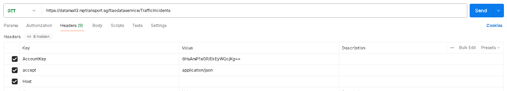

*Figure 2-1*

Figure 2-2 below shows the JSON response of an API call made for the Traffic Incidents dataset.

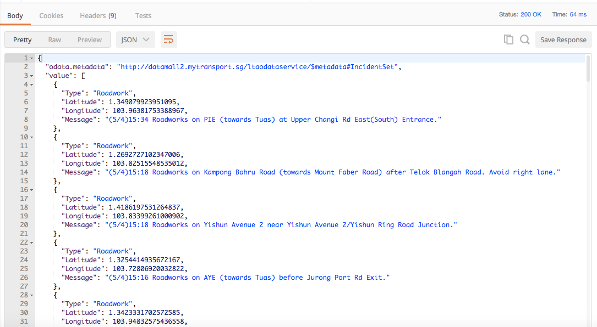

*Figure 2-2: API (JSON) Response as shown on Postman.*

With the exception of the following Bus Arrival API listed below (see Table 1), API responses returned are limited to 500 records of the dataset per call. This number may be adjusted from time to time.

To retrieve subsequent records of the dataset, you need to append the **\$skip operator** to the API call (URL). For example, to retrieve the next 500 records (501<sup>st</sup> to the 1000<sup>th</sup>), the API call should be: \
*https://datamall2.mytransport.sg/ltaodataservice/BusRoutes?****\$skip=500***

To retrieve the following set of 500 records, append ‘***?\$skip=1000***’, and so on. Just remember, each URL call returns only a max of 500 records!

| **API** | **Response Size** |
|---|---|
| Bus Arrival | Not Applicable. Depends on parameter supplied. |
| Train Service Alerts | Not Applicable. Depends on the scenario. |
| Passenger Volume related | Returns one record per request. |
| Taxi Stands | Not Applicable. Dataset is too small. |

*Table 1: API Response Size*

Following is a guide on how you can generate sample code snippets from Postman.

1. After setting up on Postman to make an API call as per the steps in *Figure 2-1,* select the code icon &lt;/&gt; in the right panel of the Postman application.

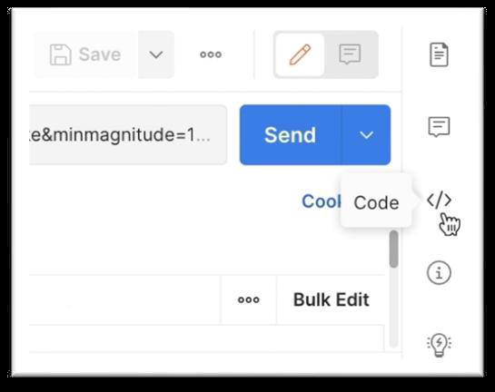

*Figure 2-3*

2. Use the dropdown list to select the code snippet in the desired programming language.

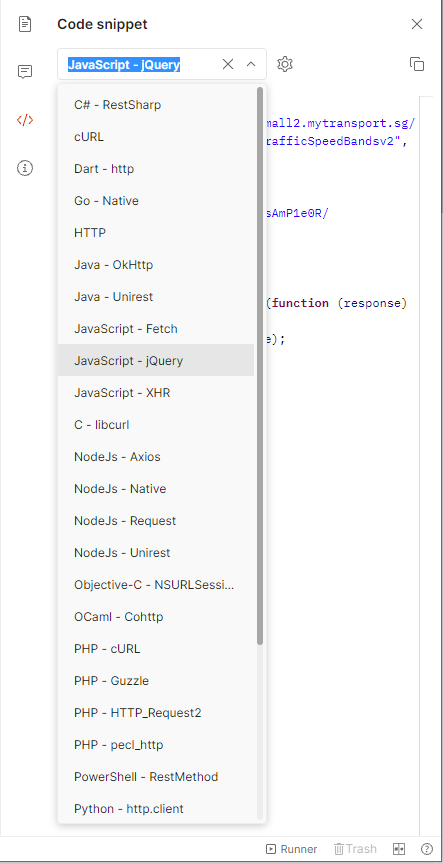

*Figure 2-4*

3. Code snippet will be automatically generated in the chosen programming language.

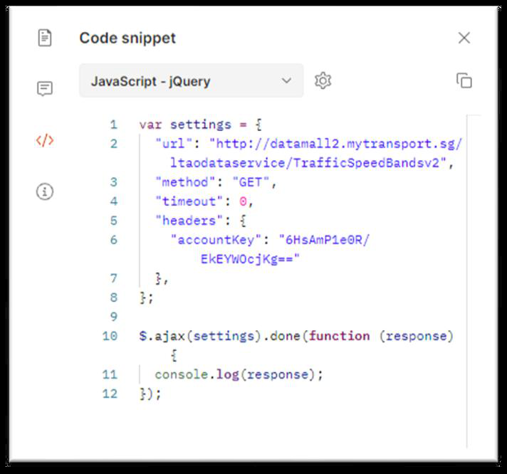

*Figure 2-5*

## 2. API DOCUMENTATION

The following lists all real-time / dynamic datasets that are refreshed at regular intervals and served out via APIs. Specification for each API can be found in the rest of this document.

*Note: any attributes not specified in this document but found on the data feed, should be ignored.*

|   |   |   |
|---|---|---|
|  | **Public-Transport Related** (Total 18) | **Description** |
| 1 | Bus Arrival | Returns real-time Bus Arrival information for Bus Services at a queried Bus Stop, including: Estimated Time of Arrival (ETA), Estimated Location, Load info (i.e. how crowded the bus is). |
| 2 | Bus Services | Returns detailed service information for all buses currently in operation, including: <br>first stop, last stop, peak / offpeak frequency of dispatch. |
| 3 | Bus Routes | Returns detailed route information for all services currently in operation, including: <br>all bus stops along each route, first/last bus timings for each stop. |
| 4 | Bus Stops | Returns detailed information for all bus stops currently being serviced by buses, including: Bus Stop Code, location coordinates. |
| 5 | Passenger Volume by Bus Stops | Returns tap in and tap out passenger volume by weekdays and weekends for individual bus stop. |
| 6 | Passenger Volume by Origin Destination Bus Stops | Returns number of trips by weekdays and weekends from the origin to destination bus stops. |
| 7 | Passenger Volume by Origin Destination Train Stations | Returns number of trips by weekdays and weekends from the origin to destination train stations. |
| 8 | Passenger Volume by Train Stations | Returns tap in and tap out passenger volume by weekdays and weekends for individual train station. |
| 9 | Taxi Availability | Returns location coordinates of all Taxis that are currently available for hire. Does not include "Hired" or "Busy" Taxis. |
| 10 | Taxi Stands | Returns detailed information of Taxi stands, such as location and whether is it barrier free |
| 11 | Train Service Alerts | Returns detailed information on train service unavailability during scheduled operating hours, such as affected line and stations etc. |
| 12 | Facilities Maintenance | Returns adhoc lift maintenance in MRT stations |
| 13 | Station Crowd Density Real-time | Returns real-time MRT/LRT station crowdedness level of a particular train network line |
| 14 | Station Crowd Density Forecast | Returns forecasted MRT/LRT station crowdedness level of a particular train network line at 30 minutes interval |
| 15 | Planned Bus Routes | Returns planned new/updated bus routes information. |
| 16 | GTFS Schedule (Train) | Returns the planned transit network. |
| 17 | GTFS Realtime (Train Service Alerts) | Returns real-time information on service disruptions, maintenance, and passenger advisories. |
| 18 | GTFS Realtime (Train Trip Updates - Disruption) | Returns real-time arrival/departure predictions, delays, cancellations, and skipped stops for scheduled trips. |
|  | **Traffic Related** (Total 11) | **Description** |
| 19 | Carpark Availability | Returns no. of available lots for HDB, LTA and URA carpark data. <br>The LTA carpark data consist of major shopping malls and developments within Orchard, Marina, HarbourFront, Jurong Lake District. |
| 20 | Estimated Travel Times | Returns estimated travel times of expressways (in segments). |
| 21 | Faulty Traffic Lights | Returns alerts of traffic lights that are currently faulty, or currently undergoing scheduled maintenance. |
| 22 | Planned Road Openings | Information on planned road openings. |
| 23 | Approved Road Works | Information on approved road works to be carried out/being carried out. |
| 24 | Traffic Images | Returns links to images of live traffic conditions along expressways and Woodlands & Tuas Checkpoints. |
| 25 | Traffic Incidents | Returns incidents currently happening on the roads, such as Accidents, Vehicle Breakdowns, Road Blocks, Traffic Diversions etc. |
| 26 | Traffic Speed Bands | Returns current traffic speeds on expressways and arterial roads, expressed in speed bands. |
| 27 | VMS / EMAS | Returns traffic advisories (via variable message services) concerning current traffic conditions that are displayed on EMAS signboards along expressways and arterial roads. |
| 28 | Traffic Flow | Returns hourly average traffic flow. |
| 29 | Flood Alerts | Returns flood alert information across Singapore, provided by PUB. |
|  | **Active Mobility Related** (Total 1) | **Description** |
| 30 | Bicycle Parking | Returns the bicycle parking locations within a radius. |
|  | **Geospatial Related** (Total 1) | **Description** |
| 31 | Geospatial Whole Island | Returns the SHP files of the requested geospatial layer |
|  | **Electric Vehicle Related** (Total 2) | **Description** |
| 32 | EV Charging Points | Returns electric vehicle charging points in Singapore and their availabilities by Postal Code. |
|  | 33 EV Charging Points Batch | Returns all electric vehicle charging points in Singapore and their availabilities in a single file. |

### 2.1 BUS ARRIVAL

|   |   |
|---|---|
| **URL** | https://datamall2.mytransport.sg/ltaodataservice/v3/BusArrival |
| **Description** | Returns real-time Bus Arrival information of Bus Services at a queried Bus Stop, including Est. Arrival Time, Est. Current Location, Est. Current Load. |
| **Update Freq** | 20 seconds |

**Request**

| **Parameters** | **Description** | **Mandatory** | **Example** |
|---|---|---|---|
| BusStopCode | Bus stop reference code | Yes | *83139* |
| ServiceNo | Bus service number | No | *15* |

**Response**

| **Attributes** | **Description** | **Example** |
|---|---|---|
| ServiceNo | Bus service number | *15* |
| Operator | Public Transport Operator Codes:<ul><li>SBST (for SBS Transit)</li><li>SMRT (for SMRT Corporation)</li><li>TTS (for Tower Transit Singapore)</li><li>GAS (for Go Ahead Singapore)</li></ul> | *GAS* |
| NextBus | Structural tags for all bus level attributes^ of the next 3 oncoming buses. Note that if there is only one last bus left on the roads (e.g. at night), attributes values in <br>NextBus2 and NextBus3 will be empty / blank. |  |
| NextBus2 |  |  |
| NextBus3 |  |  |
| ^ OriginCode | Reference code of the first bus stop where this bus started its service | *77009* |
| ^ DestinationCode | Reference code of the last bus stop where this bus will terminate its service | *77131* |
| ^ EstimatedArrival | Date-time of this bus’ estimated time of arrival, expressed in the UTC standard, GMT+8 for Singapore Standard Time (SST) | *2017-04-29T07:20:24+08:00* |
| ^ Monitored | Indicates if the bus arrival time is based on the schedule from operators.<ul><li>0 (Value from EstimatedArrival is based on schedule)</li><li>1 (Value from EstimatedArrival is estimated based on bus location)</li></ul> | *1* |
| ^ Latitude | Current estimated location coordinates of this bus at point of published data | *1.42117943692586* |
| ^ Longitude |  | *103.831477233098* |
| ^ VisitNumber | Ordinal value of the n<sup>th</sup> visit of this vehicle at this bus stop; 1=1<sup>st</sup> visit, 2=2<sup>nd</sup> visit | *1* |
| ^ Load | Current bus occupancy / crowding level:<ul><li>SEA (for Seats Available)</li><li>SDA (for Standing Available)</li><li>LSD (for Limited Standing)</li></ul> | *SEA* |
| ^ Feature | Indicates if bus is wheel-chair accessible:<ul><li>WAB</li><li>(empty / blank)</li></ul> | *WAB* |
| ^ Type | Vehicle type:<ul><li>SD (for Single Deck)</li><li>DD (for Double Deck)</li><li>BD (for Bendy)</li></ul> | *SD* |

Please note that Bus Arrival data (i.e. all attribute-value pairs above) will only appear on the API when the buses are in service (i.e. on the roads). When not in operation, OR when the API service is undergoing maintenance and temporarily unavailable, there will be no response returned on the API (not even the attribute tags).Please refer to Advisement Pt. 1 in following section for more.

**SAMPLE API CALL & RESPONSE**

**API Call:**

<https://datamall2.mytransport.sg/ltaodataservice/v3/BusArrival?BusStopCode=83139>

**API Response:**

```json
{
    "odata.metadata": "https://datamall2.mytransport.sg/ltaodataservice/v3/BusArrival",
    "BusStopCode": "83139",
    "Services": [
        {
            "ServiceNo": "15",
            "Operator": "GAS",
            "NextBus": {
                "OriginCode": "77009",
                "DestinationCode": "77009",
                "EstimatedArrival": "2024-08-14T16:41:48+08:00",
                "Monitored": 1,
                "Latitude": "1.3154918333333334",
                "Longitude": "103.9059125",
                "VisitNumber": "1",
                "Load": "SEA",
                "Feature": "WAB",
                "Type": "SD"
            },
            "NextBus2": {
                "OriginCode": "77009",
                "DestinationCode": "77009",
                "EstimatedArrival": "2024-08-14T16:49:22+08:00",
                "Monitored": 1,
                "Latitude": "1.3309621666666667",
                "Longitude": "103.9034135",
                "VisitNumber": "1",
                "Load": "SEA",
                "Feature": "WAB",
                "Type": "SD"
            },
            "NextBus3": {
                "OriginCode": "77009",
                "DestinationCode": "77009",
                "EstimatedArrival": "2024-08-14T17:06:11+08:00",
                "Monitored": 1,
                "Latitude": "1.344761",
                "Longitude": "103.94022316666667",
                "VisitNumber": "1",
                "Load": "SEA",
                "Feature": "WAB",
                "Type": "SD"
            }
        },
        {
            "ServiceNo": "150",
            "Operator": "SBST",
            "NextBus": {
                "OriginCode": "82009",
                "DestinationCode": "82009",
                "EstimatedArrival": "2024-08-14T16:55:22+08:00",
                "Monitored": 0,
                "Latitude": "0.0",
                "Longitude": "0.0",
                "VisitNumber": "1",
                "Load": "SEA",
                "Feature": "WAB",
                "Type": "SD"
            },
            "NextBus2": {
                "OriginCode": "82009",
                "DestinationCode": "82009",
                "EstimatedArrival": "2024-08-14T17:15:22+08:00",
                "Monitored": 0,
                "Latitude": "0.0",
                "Longitude": "0.0",
                "VisitNumber": "1",
                "Load": "SEA",
                "Feature": "WAB",
                "Type": "SD"
            },
            "NextBus3": {
                "OriginCode": "",
                "DestinationCode": "",
                "EstimatedArrival": "",
                "Monitored": 0,
                "Latitude": "",
                "Longitude": "",
                "VisitNumber": "",
                "Load": "",
                "Feature": "",
                "Type": ""
            }
        },
        {
            "ServiceNo": "155",
            "Operator": "SBST",
            "NextBus": {
                "OriginCode": "52009",
                "DestinationCode": "84009",
                "EstimatedArrival": "2024-08-14T16:45:23+08:00",
                "Monitored": 1,
                "Latitude": "1.3183185",
                "Longitude": "103.9003205",
                "VisitNumber": "1",
                "Load": "SEA",
                "Feature": "WAB",
                "Type": "SD"
            },
            "NextBus2": {
                "OriginCode": "52009",
                "DestinationCode": "84009",
                "EstimatedArrival": "2024-08-14T17:01:38+08:00",
                "Monitored": 1,
                "Latitude": "1.3254035",
                "Longitude": "103.88185066666667",
                "VisitNumber": "1",
                "Load": "SEA",
                "Feature": "WAB",
                "Type": "SD"
            },
            "NextBus3": {
                "OriginCode": "52009",
                "DestinationCode": "84009",
                "EstimatedArrival": "2024-08-14T17:12:38+08:00",
                "Monitored": 1,
                "Latitude": "1.3282046666666667",
                "Longitude": "103.8799955",
                "VisitNumber": "1",
                "Load": "SEA",
                "Feature": "WAB",
                "Type": "SD"
            }
        }
    ]
}
```

**ADVISEMENT ON FRONT-END IMPLEMENTATION (BUS APPS)**

1. **\[EstimatedArrival\] Display of Advisement Messages when there is NO Bus Arrival Data**

In the event where data is not available (be it in partial or in full) on the API, you may want to display some form of ‘status texts’ to advise your app users on what’s going on, as far as bus service availability is concerned. To do this, you will need to take reference from two data points – (1) the presence or **absence** of Arrival data itself, and (2) the **bus service operating hours at each bus stop** which you need to obtain via the **Bus Routes API**.

With those two data points gathered, you will arrive at the following possible scenarios:

| **#** | **Operation Status** | **Data Availability** | **Advisement Message** |
|---|---|---|---|
| a. | Bus is in operation | Arrival data is available | (none required) |
| b. | Bus is in operation | Arrival data is NOT available | “*No Est. Available*” |
| c. | Bus is NOT in operation | Arrival data is NOT available | “*Not In Operation*” |
| d. | Bus is NOT in operation | Arrival data is available | (none required) |

For scenarios (b) and (c), you may display advisement messages like those suggested in the table above, or any other user-friendly and appropriate variants at your discretion.

Next, you should note that Arrival data may be available on the API even when bus services are supposedly NOT in operation (as per scheduled operating hours) – reflected as scenario (d) in the table above. This happens,

- a. before first bus(es) begin their service from Bus Interchanges / Depots in the mornings, and,
- b. when last bus(es) at night are running behind schedule; slightly past operating hours.

Therefore, the general logic to be applied, is to **always first display the Arrival data if it’s available on the API**, irrespective of the scheduled operating hours. Advisement messages like “*No Est. Available*” and “*Not In Operation*” are applicable ONLY when there is no Arrival data on the API.

2. **\[EstimatedArrival\] Rounding of Seconds**

All derived bus arrival duration should be rounded down to the nearest minute.

Derived duration: 3:49 mins \
Display duration: “3 min”

Derived duration: 2:07 mins \
Display duration: “2 min”

Derived duration: 1:59 mins \
Display duration: “1 min”

Derived duration: 0:59 mins \
Display duration: “Arr”

3. **\[Load\] Colour Scheme Adoption**

You may adopt this colour scheme to serve as visual indicators for the various loading values:

- \[Green\] Seats Available
- \[Amber\] Standing Available
- \[Red\] Limited Standing

You are given the flexibility for the manner in which you display the colours, i.e. colour bars, coloured timings, and accompanied with legends where appropriate and/or necessary.

4. **\[Feature\] Wheelchair Accessible Buses**

You are given the flexibility to display any symbols or labels  to denote oncoming buses that are wheelchair accessible.

5. **\[Feature\] Schedule Indicator**

You are given the flexibility to display any symbols or labels  to indicate if the bus arriving times are based on the schedule from operators and may be subject to changes.

**ADDITIONAL NOTE ON LOOP SERVICES THAT RUNS BOTH DIRECTIONS**

Please note that some Loop Services are appended with **‘G’** or **‘W’** to denote their direction of travel. You should account for and display these services individually – 225G, 225W, 243G, 243W, 410G, 410W.

### 2.2 BUS SERVICES

|   |   |
|---|---|
| **URL** | https://datamall2.mytransport.sg/ltaodataservice/BusServices |
| **Description** | Returns detailed service information for all buses currently in operation, including: first stop, last stop, peak / offpeak frequency of dispatch. |
| **Update Freq** | Ad hoc |

**Request**

| **Parameters** | **Description** | **Mandatory** | **Example** |
|---|---|---|---|
| ServiceNo | The bus service number | No | *107M* |

**Response**

| **Attributes** | **Description** | **Sample** |
|---|---|---|
| ServiceNo | The bus service number | *107M* |
| Operator | Operator for this bus service | *SBST* |
| Direction | The direction in which the bus travels (1 or 2), loop services only have 1 direction | *1* |
| Category | Category of the SBS bus service: EXPRESS, FEEDER, INDUSTRIAL, TOWNLINK, TRUNK, 2 TIER FLAT FEE, FLAT FEE \$1.10 (or \$1.90, \$3.50, \$3.80) | *TRUNK* |
| OriginCode | Bus stop code for first bus stop | *64009* |
| DestinationCode | Bus stop code for last bus stop (similar as first stop for loop services) | *64009* |
| AM\_Peak\_Freq | Freq of dispatch for AM Peak <br>0630H - 0830H (range in minutes) | *14-17* |
|  | AM\_Offpeak\_Freq Freq of dispatch for AM Off-Peak<br>0831H - 1659H (range in minutes) | *10-16* |
| PM\_Peak\_Freq | Freq of dispatch for PM Peak <br>1700H - 1900H (range in minutes)<br>PM\_Offpeak\_Freq Freq of dispatch for PM Off-Peak<br>after 1900H (range in minutes) | *12-15*<br>*12-15* |
| LoopDesc | Location at which the bus service loops, empty if not a loop service. | *Raffles Blvd* |

### 2.3 BUS ROUTES

|   |   |
|---|---|
| **URL** | https://datamall2.mytransport.sg/ltaodataservice/BusRoutes |
| **Description** | Returns detailed route information for all services currently in operation, including: all bus stops along each route, first/last bus timings for each stop. |
| **Update Freq** | Ad hoc |

**Response**

| **Attributes** | **Description** | **Sample** |
|---|---|---|
| ServiceNo | The bus service number | *107M* |
| Operator | Operator for this bus service | *SBST* |
| Direction | The direction in which the bus travels <br>(1 or 2), loop services only have 1 direction | *1* |
| StopSequence | The i-th bus stop for this route | *28* |
| BusStopCode | The unique 5-digit identifier for this physical bus stop | *01219* |
| Distance | Distance travelled by bus from starting location to this bus stop (in kilometres) | *10.3* |
| WD\_FirstBus | Scheduled arrival of first bus on weekdays | *2025* |
| WD\_LastBus | Scheduled arrival of last bus on weekdays | *2352* |
| SAT\_FirstBus | Scheduled arrival of first bus on Saturdays | *1427* |
| SAT\_LastBus | Scheduled arrival of last bus on Saturdays | *2349* |
| SUN\_FirstBus | Scheduled arrival of first bus on Sundays | *0620* |
| SUN\_LastBus | Scheduled arrival of last bus on Sundays | *2349* |

### 2.4 BUS STOPS

|   |   |
|---|---|
| **URL** | https://datamall2.mytransport.sg/ltaodataservice/BusStops |
| **Description** | Returns detailed information for all bus stops currently being serviced by buses, including: Bus Stop Code, location coordinates. |
| **Update Freq** | Ad hoc |

**Request**

| **Parameters** | **Description** | **Mandatory** | **Example** |
|---|---|---|---|
| BusStopCode | The unique 5-digit identifier for this physical bus stop | No | *01012* |

**Response**

| **Attributes** | **Description** | **Sample** |
|---|---|---|
| BusStopCode | The unique 5-digit identifier for this physical bus stop | *01012* |
| RoadName | The road on which this bus stop is located | *Victoria St* |
| Description | Landmarks next to the bus stop (if any) to aid in identifying this bus stop | *Hotel Grand Pacific* |
| Latitude | Location coordinates for this bus stop | *1.29685* |
| Longitude |  | *103.853* |

### 2.5 PASSENGER VOLUME BY BUS STOPS

|   |   |
|---|---|
| **URL** | https://datamall2.mytransport.sg/ltaodataservice/PV/Bus |
| **Description** | Returns tap in and tap out passenger volume by weekdays and weekends for individual bus stop |
| **Update Freq** | By 10<sup>th</sup> of every month, the passenger volume for previous month data will be generated |

**Request**

| **Parameters** | **Description** | **Mandatory** | **Example** |
|---|---|---|---|
| Date | Request for files up to last three months | No | *Date=201803* |

**Response**

| **Attributes** | **Description** | **Example** |
|---|---|---|
| Link | <ul><li>Link for downloading this file.</li><li>Refer to sample output on <br>Annex A for reference.</li><li>Link will expire after 15 minutes.</li></ul> | *https://ltafarecard.s3.amazona ws.com/201803/transport\_node \_bus\_201803.zip?x-amz- security- token=FQoDYXdzEOf%2F%2F% 2F%2F%2F%2F%2F%2F%2F%...* |

### 2.6 PASSENGER VOLUME BY ORIGIN DESTINATION BUS STOPS

|   |   |
|---|---|
| **URL** | https://datamall2.mytransport.sg/ltaodataservice/PV/ODBus |
| **Description** | Returns number of trips by weekdays and weekends from origin to destination bus stops |
| **Update Freq** | By 10<sup>th</sup> of every month, the passenger volume for previous month data will be generated |

**Request**

| **Parameters** | **Description** | **Mandatory** | **Example** |
|---|---|---|---|
| Date | Request for files up to last three months | No | *Date=201804* |

**Response**

| **Attributes** | **Description** | **Example** |
|---|---|---|
| Link | <ul><li>Link for downloading this file.</li><li>Refer to sample output on <br>Annex B for reference.</li><li>Link will expire after 15 minutes.</li></ul> | *https://ltafarecard.s3.amazona ws.com/201804/origin\_destinat ion\_bus\_201804.zip?x-amz- security- token=FQoDYXdzEOf%2F%2...* |

### 2.7 PASSENGER VOLUME BY ORIGIN DESTINATION TRAIN STATIONS

|   |   |
|---|---|
| **URL** | https://datamall2.mytransport.sg/ltaodataservice/PV/ODTrain |
| **Description** | Returns number of trips by weekdays and weekends from origin to destination train stations |
| **Update Freq** | By 10<sup>th</sup> of every month, the passenger volume for previous month data will be generated |

**Request**

| **Parameters** | **Description** | **Mandatory** | **Example** |
|---|---|---|---|
| Date | Request for files up to last three months | No | *Date=201803* |

**Response**

| **Attributes** | **Description** | **Example** |
|---|---|---|
| Link | <ul><li>Link for downloading this file.</li><li>Refer to sample output on <br>Annex B for reference.</li><li>Link will expire after 15 minutes.</li></ul> | *https://ltafarecard.s3.amazona ws.com/201803/origin\_destinat ion\_train\_201803.zip?x-amz- security- token=FQoDYXdzEOf%2F%2F% ...* |

### 2.8 PASSENGER VOLUME BY TRAIN STATIONS

|   |   |
|---|---|
| **URL** | https://datamall2.mytransport.sg/ltaodataservice/PV/Train |
| **Description** | Returns tap in and tap out passenger volume by weekdays and weekends for individual train station |
| **Update Freq** | By 10<sup>th</sup> of every month, the passenger volume for previous month data will be generated |

**Request**

| **Parameters** | **Description** | **Mandatory** | **Example** |
|---|---|---|---|
| Date | Request for files up to last three months | No | *Date=201805* |

**Response**

| **Attributes** | **Description** | **Example** |
|---|---|---|
| Link | <ul><li>Link for downloading this file.</li><li>Refer to sample output on <br>Annex A for reference.</li><li>Link will expire after 15 minutes.</li></ul> | *https://ltafarecard.s3.amazona ws.com/201805/transport\_node \_train\_201805.zip?x-amz- security- token=FQoDYXdzEOf%2F%2F% 2F...* |

### 2.9 TAXI AVAILABILITY

|   |   |
|---|---|
| **URL** | https://datamall2.mytransport.sg/ltaodataservice/Taxi-Availability |
| **Description** | Returns location coordinates of all Taxis that are currently available for hire. Does not include "Hired" or "Busy" Taxis. |
| **Update Freq** | 1 min |

**Response**

| **Attributes** | **Description** | **Sample** |
|---|---|---|
| Latitude | Latitude location coordinates. | *1.35667* |
| Longitude | Longitude location coordinates. | *103.93314* |

### 2.10 TAXI STANDS

|   |   |
|---|---|
| **URL** | https://datamall2.mytransport.sg/ltaodataservice/TaxiStands |
| **Description** | Returns detailed information of Taxi stands, such as location and whether is it barrier free. |
| **Update Freq** | Monthly |

**Response**

| **Attributes** | **Description** | **Sample** |
|---|---|---|
| TaxiCode | Code representation of Taxi facility. | *A01* |
| Latitude | Latitude map coordinates for the start point of this road incident. | *1.303980684* |
| Longitude | Longitude map coordinates for the start point of this incident. | *103.9191828* |
| Bfa | Indicate whether the Taxi stand is barrier free. | *Yes* |
| Ownership | Indicate the owner of the Taxi stand.<br>LTA – Land Transport Authority<br>CCS – Clear Channel Singapore<br>Private – Taxi facilities that are constructed and maintained by private entities (e.g. developers/owners of shopping malls, commercial buildings). | *LTA* <br>*CCS* <br>*Private* |
| Type | Stand - allows Taxis to queue in the taxi bays and wait for passengers. <br>Stop - allow Taxis to perform immediate pick up and drop off of passengers. | *Stand* <br>*Stop* |
| Name | Name of Taxi facility. | *Orchard Rd along driveway of Luc ky Plaza* |

### 2.11 TRAIN SERVICE ALERTS

|   |   |
|---|---|
| **URL** | https://datamall2.mytransport.sg/ltaodataservice/TrainServiceAlerts |
| **Description** | Returns detailed information on train service **unavailability** during scheduled operating hours, such as affected line and stations etc. |
| **Update Freq** | Ad hoc |

**Request**

| **Parameters** | **Description** | **Mandatory** | **Example** |
|---|---|---|---|
| (none) | - | - | *-* |

**Response**

| **Attributes** | **Description** | **Example** |
|---|---|---|
| Status | Indicates if train service is unavailable:<ul><li>1 (for Normal Train Service or Minor Delays)</li><li>2 (for Disrupted Train Service or Major Delays)</li></ul> | *2* |
| Line | Train network line affected:<ul><li>EWL (for East West Line and Changi Extension – Expo, Changi Airport)</li><li>NSL (for North South Line)</li><li>NEL (for North East Line)</li><li>CCL (for Circle Line and Circle Line Extension – BayFront, Marina Bay)</li><li>DTL (for Downtown Line)</li><li>TEL (for Thomson-East Coast Line)</li><li>BPL (for Bukit Panjang LRT)</li><li>STL (for Sengkang LRT)</li><li>PTL (for Punggol LRT)</li></ul> | *NEL* |
| Direction | Indicates direction of service unavailability on the affected line:<ul><li>Both</li><li>(towards station name)</li></ul> | *Punggol* |
| Stations | Indicates the list of affected stations on the affected line. | *NE1,NE3,NE4,NE5,NE6* |
| FreePublicBus | Indicates the list of affected stations where free boarding onto **normal public bus services** are available.<ul><li>(station code)</li><li>Free bus service island wide</li></ul> | *NE1,NE3,NE4,NE5,NE6* |
| FreeMRTShuttle | Indicates the list of affected stations where **free MRT shuttle services^** are available.<ul><li>(station code)</li><li>EW21\|CC22,EW23,EW24\|NS1, EW27;NS9,NS13,NS16,NS17\|CC15; EW8\|CC9,EW5,EW2;NS1\|EW24,NS4\|BP1<strong>\*</strong></li></ul> | *NE1,NE3,NE4,NE5,NE6* |
| MRTShuttleDirection | Indicates the direction of free MRT shuttle services available:<ul><li>Both</li><li>(towards station name)</li></ul> | *Punggol* |
| Message | Travel advisory notification service for train commuters, published by LTA. This notice is also broadcasted to commuters via the Find-My-Way module in MyTransport mobile app.<ul><li>Content</li><li>CreatedDate</li></ul> | *1710hrs: NEL – No train service between Harbourfront to Dhoby Ghaut stations towards Punggol station due to a signalling fault. Free bus rides are available at designated bus stops.*<br>*2017-12-01 17:54:21* |

Note:

- This API relies on the static master list of Train Station Codes, Train Line Codes and Train Shuttle Service Direction which can be obtained on [DataMall Portal](http://www.mytransport.sg/content/mytransport/home/dataMall.html) .
  - The Train Station Codes and Train Line Codes files are under Public Transport section.
  - The Train Shuttle Service Direction information can be found in Train Line Codes file.
- During train unavailability, following attributes will be mandatory.
  - Status
  - Line
  - Direction
  - Stations
- Each line that is affected will be published as separate clusters within the single API response. Refer to sample output on Annex C for reference.
- <strong>^</strong>Free MRT Shuttle services will ferry commuters from station to station along the affected stretch.
- <strong>\*</strong>There are scenarios which MRT Shuttle services do not run along the affected stretch but along four predefined areas in both directions
  - Bouna Vista, Clementi, Jurong East and Boon Lay
  - Woodlands, Yishun, Ang Mo Kio, Bishan
  - Paya Lebar, Bedok, Tampines
  - Jurong East, Choa Chu Kang
  - “\|” delimiter to denote an interchange station
  - “;” delimiter to denote end of an area

### 2.12 CARPARK AVAILABILITY

|   |   |
|---|---|
| **URL** | https://datamall2.mytransport.sg/ltaodataservice/CarParkAvailabilityv2 |
| **Description** | Returns no. of available lots for HDB, LTA and URA carpark data.<br>The LTA carpark data consist of major shopping malls and developments within Orchard, Marina, HarbourFront, Jurong Lake District.<br>*(Note: list of LTA carpark data available on this API is subset of those listed on One.Motoring and MyTransport Portals)* |
| **Update Freq** | 1 minute |

**Response**

| **Attributes** | **Description** | **LTA Sample** | **URA Sample** | **HDB Sample** |
|---|---|---|---|---|
| CarParkID | A unique code for this carpark | *1* | *A0007* | *KB7* |
| Area | Area of development / building:<ul><li>Orchard</li><li>Marina</li><li>Harbfront</li><li>JurongLakeDistrict</li></ul> | *Marina* | *(blank)* | *(blank)* |
| Development | Major landmark or address where carpark is located | *Suntec City* | *ANGULLIA PARK OFF STREET* | *BLK 69 GEYLANG BAHRU* |
| Location | Latitude and Longitude map coordinates. | *1.29375 103.85718* | *1.305328… 103.82957...* | *1.32158.. 103.87047…* |
| AvailableLots | Number of lots available at point of data retrieval. | *352* | *0* | *18* |
| LotType | Type of lots:<ul><li>C (for Cars)</li><li>H (for Heavy Vehicles)</li><li>Y (for Motorcycles)</li></ul> | *C* | *Y* | *C* |
| Agency | Agencies:<ul><li>HDB</li><li>LTA</li><li>URA</li></ul> | *LTA* | *URA* | *HDB* |

Respective agencies are responsible for the accuracy of the carpark data. If there is any data related issue, you \
may contact the agency directly. There may be empty values if data is not available (e.g. Area for HDB and URA data is unavailable hence blank value is expected).

### 2.13 ESTIMATED TRAVEL TIMES

|   |   |
|---|---|
| **URL** | https://datamall2.mytransport.sg/ltaodataservice/EstTravelTimes |
| **Description** | Returns estimated travel times of expressways (in segments). |
| **Update Freq** | 5 minutes |

**Response**

| **Attributes** | **Description** | **Sample** |
|---|---|---|
| Name | Expressway | *AYE* |
| Direction | Direction of travel:<br>1 – Travelling from east to west, or south to north. <br>2 – Travelling from west to east, or north to south. | *1* |
| FarEndPoint | The final end point of this whole expressway in current direction of travel | *TUAS CHECKPOINT* |
| StartPoint | Start point of this current segment | *AYE/MCE INTERCHANGE* |
| EndPoint | End point of this current segment | *TELOK BLANGAH RD* |
| EstTime | Estimated travel time in minutes | *2* |

### 2.14 FAULTY TRAFFIC LIGHTS

|   |   |
|---|---|
| **URL** | https://datamall2.mytransport.sg/ltaodataservice/v2/FaultyTrafficLights |
| **Description** | Returns alerts of traffic lights that are currently faulty, or currently undergoing scheduled maintenance. |
| **Update Freq** | 2 minutes – whenever there are updates |

**Response**

| **Attributes** | **Description** | **Sample** |
|---|---|---|
| AlarmID | Technical alarm ID | *GL703034136* |
| NodeID | A unique code to represent each unique traffic light node | *703034136* |
| Type | Type of the technical alarm<ul><li>2 (Blackout)</li><li>13 (Flashing Yellow)</li></ul> | *13* |
| StartDate | YYYY-MM-DD HH:MM:SS.ms | *2014-04-12 01:58:00.0* |
| EndDate | YYYY-MM-DD HH:MM:SS.ms (empty field if this is not a scheduled maintenance) |  |
| XCoordinate | X Coordinate in SVY21 coordinate system | *20786.6* |
| YCoordinate | Y Coordinate in SVY21 coordinate system | *32521.5* |
| Message | Canning Message | *(23/1) 8:58 Flashing Yellow at Bedok North Interchange/Bedok North Street 1 Junc.* |

### 2.15 PLANNED ROAD OPENINGS

|   |   |
|---|---|
| **URL** | https://datamall2.mytransport.sg/ltaodataservice/RoadOpenings |
| **Description** | Information on planned road openings. |
| **Update Freq** | 24 hours – whenever there are updates |

**Response**

| **Attributes** | **Description** | **Sample** |
|---|---|---|
| EventID | ID for this road opening event | *RMAPP-201603-0900* |
| StartDate | Start date for works to be performed for this road opening (in YYYY-MM-DD format) | *2016-03-31* |
| EndDate | End date for works to be performed for this road opening (in YYYY-MM-DD format) | *2016-09-30* |
| SvcDept | Department or company performing this road work | *SP POWERGRID LTD - CUSTOMER PROJ (EAST)* |
| RoadName | Name of new road to be opened | *AH SOO GARDEN* |
| Other | Additional information or messages | *For details, please call 62409237* |

### 2.16 APPROVED ROAD WORKS

|   |   |
|---|---|
| **URL** | https://datamall2.mytransport.sg/ltaodataservice/RoadWorks |
| **Description** | Information on approved road works to be carried out/being carried out. |
| **Update Freq** | 24 hours – whenever there are updates |

**Response**

| **Attributes** | **Description** | **Sample** |
|---|---|---|
| EventID | ID for this road work | *RMAPP-201512-0217* |
| StartDate | Start date for the works performed for this road work (in YYYY-MM-DD format) | *2015-12-14* |
| EndDate | End date for works performed for this road work <br>(in YYYY-MM-DD format) | *2016-07-31* |
| SvcDept | Department or company performing this road work | *SP POWERGRID LTD - REGIONAL NETWORK CENTRAL* |
| RoadName | Name of road where work is being performed. | *ADAM DRIVE* |
| Other | Additional information or messages. | *For details, please call 67273085* |

### 2.17 TRAFFIC IMAGES

|   |   |
|---|---|
| **URL** | https://datamall2.mytransport.sg/ltaodataservice/Traffic-Imagesv2 |
| **Description** | Returns links to images of live traffic conditions along expressways and Woodlands & Tuas Checkpoints. |
| **Update Freq** | 1 to 5 minutes |

**Response**

| **Attributes** | **Description** | **Sample** |
|---|---|---|
| CameraID | A unique ID for this camera<br>For mapping this attribute to specific location descriptions, please refer to **ANNEX G**. | *5795* |
| Latitude | Latitude map coordinates | *1.326024822* |
| Longitude | Longitude map coordinates | *103.905625* |
| ImageLink | <ul><li>Link for downloading this image.</li><li>Link will expire after 15 minutes.</li></ul> | *https://dm-traffic-camera- itsc.s3.amazonaws.com/2020-04-01/09- 24/1001\_0918\_20200401092500\_e0368e.jpg?x- amz-security- token=IQoJb3JpZ2luX2VjEBkaDmFwL...* |

### 2.18 TRAFFIC INCIDENTS

|   |   |
|---|---|
| **URL** | https://datamall2.mytransport.sg/ltaodataservice/TrafficIncidents |
| **Description** | Returns incidents currently happening on the roads, such as Accidents, Vehicle Breakdowns, Road Blocks, Traffic Diversions etc. |
| **Update Freq** | 2 minutes – whenever there are updates |

**Response**

| **Attributes** | **Description** | **Sample** |
|---|---|---|
| Type | Incident Types:<ul><li>Accident</li><li>Roadwork</li><li>Vehicle breakdown</li><li>Weather</li><li>Obstacle</li><li>Road Block</li><li>Heavy Traffic</li><li>Miscellaneous</li><li>Diversion</li><li>Unattended Vehicle</li><li>Fire</li><li>Plant Failure</li><li>Reverse Flow</li></ul> | *Vehicle breakdown* |
| Latitude | Latitude map coordinates for the start point of this road incident | *1.30398068448214* |
| Longitude | Longitude map coordinates for the start point of this incident | *103.919182834377* |
| Message | Description message for this incident | *(29/3)18:22 Vehicle breakdown on ECP (towards Changi Airport) after Still Rd Sth Exit. Avoid lane 3.* |

### 2.19 TRAFFIC SPEED BANDS

|   |   |
|---|---|
| **URL** | https://datamall2.mytransport.sg/ltaodataservice/v4/TrafficSpeedBands |
| **Description** | Returns current traffic speeds on expressways and arterial roads, expressed in speed bands. |
| **Update Freq** | 5 minutes |

**Response**

| **Attributes** | **Description** | **Sample** |
|---|---|---|
| LinkID | Unique ID for this stretch of road | *1* |
| RoadName | Road Name | *SERANGOON ROAD* |
| RoadCategory | 1 – Expressways <br>2 – Major Arterial Roads <br>3 – Arterial Roads <br>4 – Minor Arterial Roads <br>5 – Small Roads <br>6 – Slip Roads <br>8 – Short Tunnels | *2* |
| SpeedBand | Speed Bands Information. Total: 8<br>1 – indicates speed range from 0 &lt; 9 <br>2 – indicates speed range from 10 &lt; 19 <br>3 – indicates speed range from 20 &lt; 29 <br>4 – indicates speed range from 30 &lt; 39 <br>5 – indicates speed range from 40 &lt; 49 <br>6 – indicates speed range from 50 &lt; 59 <br>7 – indicates speed range from 60 &lt; 69 <br>8 – speed range from 70 or more | *2* |
| MinimumSpeed | Minimum speed in km/h | *10* |
| MaximumSpeed | Maximum speed in km/h | *19* |
| StartLon | Longitude map coordinates for start point for this stretch of road. | *103.86246461405193* |
| StartLat | Latitude map coordinates for start point for this stretch of road. | *1.3220591510051254* |
| EndLon | Longitude map coordinates for end point for this stretch of road. | *103.86315591911669* |
| EndLat | Latitude map coordinates for start point for this stretch of road. | *1.3215993547809128* |

### 2.20 VMS / EMAS

|   |   |
|---|---|
| **URL** | https://datamall2.mytransport.sg/ltaodataservice/VMS |
| **Description** | Returns traffic advisories (via variable message services) concerning current traffic conditions that are displayed on EMAS signboards along expressways and arterial roads. |
| **Update Freq** | 2 minutes |

**Response**

| **Attributes** | **Description** | **Sample** |
|---|---|---|
| EquipmentID | EMAS equipment ID | *amvms\_v9104* |
| Latitude | Latitude map coordinates of electronic signboard. | *1.3927176306916775* |
| Longitude | Longitude map coordinates of electronic signboard. | *103.82618266340947* |
| Message | Variable Message being displayed on the EMAS display. | *VEH BREAKDOWN SH,AFT U.THOMSON* |

### 2.21 BICYCLE PARKING

|   |   |
|---|---|
| **URL** | https://datamall2.mytransport.sg/ltaodataservice/v3/BicycleParking |
| **Description** | Returns bicycle parking locations within a radius. The default radius is set as 0.5km |
| **Update Freq** | Monthly |

**Request**

| **Parameters** | **Description** | **Mandatory** | **Example** |
|---|---|---|---|
| Lat | Latitude map coordinates of location | Yes | *1.364897* |
| Long | Longitude map coordinates of location | Yes | *103.766094* |
| Dist | Radius in kilometre | No | *Default is 0.5* |

**Response**

| **Attributes** | **Description** | **Example** |
|---|---|---|
| Description | Brief description of bicycle parking location. | *Bus Stop 43267* |
| Latitude | Latitude map coordinates of bicycle parking location. | *1.3927176306916775* |
| Longitude | Longitude map coordinates of bicycle parking location. | *103.82618266340947* |
| RackType | Ownership and type of bicycle parking facility | *Racks or Yellow Box* |
| RackCount | Total number of bicycle parking lots. | *10* |
| ShelterIndicator | Indication if the bicycle parking lots are sheltered. | *Y* |
| SharedBicycleParking | Indication if the bicycle parking facility allows for shared bicycle parking. | *Yes* |
| Type | Type of bicycle parking facility. | *RACK* |

### 2.22 GEOSPATIAL WHOLE ISLAND

|   |   |
|---|---|
| **URL** | https://datamall2.mytransport.sg/ltaodataservice/GeospatialWholeIsla nd |
| **Description** | Returns the SHP files of the requested geospatial layer |
| **Update Freq** | Ad hoc |

**Request**

| **Parameters** | **Description** | **Mandatory** | **Example** |
|---|---|---|---|
| ID | Name of Geospatial Layer. Refer to **ANNEX E** for the list of Geospatial layers<br>(Case Sensitive, omit space.) | Yes | *ArrowMarking* |

**Response**

| **Attributes** | **Description** | **Example** |
|---|---|---|
| Link | <ul><li>Link for downloading this file.</li><li>Link will expire after 15 minutes.</li></ul> | *https://dmgeospatial.s3.ap- southeast- 1.amazonaws.com/ArrowMa rking.zip?X-Amz-Security- Token=IQoJb3JpZ2luX2VjEG* |

### 2.23 FACILITIES MAINTENANCE

|   |   |
|---|---|
| **URL** | https://datamall2.mytransport.sg/ltaodataservice/v2/FacilitiesMaintena nce |
| **Description** | Returns adhoc lift maintenance in MRT stations. |
| **Update Freq** | Ad hoc |

**Response**

| **Attributes** | **Description** | **Example** |
|---|---|---|
| Line | Code of train network line. | *NEL* |
| StationCode | Code of train station. | *NE12* |
| StationName | Name of train station. | *Serangoon* |
| LiftID | ID of the lift which is currently under maintenance. <br>This value is optional. | *B1L01* |
| LiftDesc | Detailed description of the lift which is currently under maintenance. | *Exit B Street level - Concourse* |

### 2.24 STATION CROWD DENSITY REAL TIME

|   |   |
|---|---|
| **URL** | https://datamall2.mytransport.sg/ltaodataservice/PCDRealTime |
| **Description** | Returns real-time MRT/LRT station crowdedness level of a particular train network line |
| **Update Freq** | 10 minutes |

**Request**

| **Parameters** | **Description** | **Mandatory** | **Example** |
|---|---|---|---|
| TrainLine | Code of train network line. <br>Train lines supported:<ul><li>CCL (for Circle Line)</li><li>CEL (for Circle Line Extension – BayFront, Marina Bay)</li><li>CGL (for Changi Extension – Expo, Changi Airport)</li><li>DTL (for Downtown Line)</li><li>EWL (for East West Line)</li><li>NEL (for North East Line)</li><li>NSL (for North South Line)</li><li>BPL (for Bukit Panjang LRT)</li><li>SLRT (for Sengkang LRT)</li><li>PLRT (for Punggol LRT)</li><li>TEL (for Thomson-East Coast Line)</li></ul> | Yes | *EWL* |

**Response**

| **Attributes** | **Description** | **Example** |
|---|---|---|
| Station | Station code | EW13 |
| StartTime | The start of the time interval | 2021-09- 15T09:40:00+08:00 |
| EndTime | The end of the time interval | 2021-09- 15T09:50:00+08:00 |
| CrowdLevel | The crowdedness level indicates:<ul><li>l: low</li><li>h: high</li><li>m: moderate</li><li>NA</li></ul> | l |

### 2.25 STATION CROWD DENSITY FORECAST

|   |   |
|---|---|
| **URL** | https://datamall2.mytransport.sg/ltaodataservice/PCDForecast |
| **Description** | Returns forecasted MRT/LRT station crowdedness level of a particular train network line at 30 minutes interval |
| **Update Freq** | 24 hours |

**Request**

| **Parameters** | **Description** | **Mandatory** | **Example** |
|---|---|---|---|
| TrainLine | Code of train network line. <br>Train lines supported:<ul><li>CCL (for Circle Line)</li><li>CEL (for Circle Line Extension – BayFront, Marina Bay)</li><li>CGL (for Changi Extension – Expo, Changi Airport)</li><li>DTL (for Downtown Line)</li><li>EWL (for East West Line)</li><li>NEL (for North East Line)</li><li>NSL (for North South Line)</li><li>BPL (for Bukit Panjang LRT)</li><li>SLRT (for Sengkang LRT)</li><li>PLRT (for Punggol LRT)</li><li>TEL (for Thomson-East Coast Line)</li></ul> | Yes | *NSL* |

**Response**

| **Attributes** | **Description** | **Example** |
|---|---|---|
| Date | Midnight of the forecasted date | 2021-09- 15T00:00:00+08:00 |
| Station | Station code | NS1 |
| Start | The start of the time interval | 2021-09- 15T00:00:00+08:00 |
| CrowdLevel | The crowdedness level indicates:<ul><li>l: low</li><li>h: high</li><li>m: moderate</li><li>NA</li></ul> | l |

### 2.26 TRAFFIC FLOW

|   |   |
|---|---|
| **URL** | https://datamall2.mytransport.sg/ltaodataservice/TrafficFlow |
| **Description** | Returns hourly average traffic flow, taken from a representative month of every quarter during 0700-0900 hours. |
| **Update Freq** | Quarterly |

**Response**

| **Attributes** | **Description** | **Example** |
|---|---|---|
| Link | <ul><li>Link for downloading this file.</li><li>Link will expire after 15 minutes.</li></ul> | *https://dm-traffic-flow- data.s3.ap-southeast- 1.amazonaws.com/trafficflow.js on?X-Amz-Security- Token=IQoJb3JpZ2luX2VjE...* |

### 2.27 PLANNED BUS ROUTES

|   |   |
|---|---|
| **URL** | https://datamall2.mytransport.sg/ltaodataservice/PlannedBusRoutes |
| **Description** | Returns planned new/updated bus routes information. <br>**Important Note: Data to be released only ON/AFTER the Effective Date.** |
| **Update Freq** | Ad hoc |

**Response**

| **Attributes** | **Description** | **Example** |
|---|---|---|
| ServiceNo | The bus service number | *107M* |
| Operator | Operator for this bus service | *SBST* |
| Direction | The direction in which the bus travels (1 or 2), loop services only have 1 direction | *1* |
| StopSequence | The i-th bus stop for this route | *28* |
| BusStopCode | The unique 5-digit identifier for this physical bus stop | *01219* |
| Distance | Distance travelled by bus from starting location to this bus stop (in kilometres) | *10.3* |
| WD\_FirstBus | Scheduled arrival of first bus on weekdays | *2025* |
| WD\_LastBus | Scheduled arrival of last bus on weekdays | *2352* |
| SAT\_FirstBus | Scheduled arrival of first bus on Saturdays | *1427* |
| SAT\_LastBus | Scheduled arrival of last bus on Saturdays | *2349* |
| SUN\_FirstBus | Scheduled arrival of first bus on Sundays | *0620* |
| SUN\_LastBus | Scheduled arrival of last bus on Sundays | *2349* |
| EffectiveDate | The date when the new/update bus routes will take effect. | *20250302T00:00:00+0800* |

### 2.28 ELECTRIC VEHICLE CHARGING POINTS

|   |   |
|---|---|
| **URL** | https://datamall2.mytransport.sg/ltaodataservice/EVChargingPoints |
| **Description** | Returns electric vehicle charging points in Singapore and their availabilities by Postal Code. |
| **Update Freq** | 5 minutes |

**Request**

| **S/N** | **Parameters** | **Description** | **Mandatory** | **Example** |
|---|---|---|---|---|
| 1 | PostalCode | Postal code of the location | Yes | *123456* |
|  | **Response** |  |  |  |

| **S/N** | **Attributes** | **Description** | **Example** |
|---|---|---|---|
| 2 | address | Address of the charging station | *123 Road A Singapore 123456* |
| 3 | name | Name of charging station | *123 Road A* |
| 4 | longtitude | Longitude map coordinates of charging station | *103.123456* |
| 5 | latitude | Latitude map coordinates of charging station | *1.123456* |
| 6 | locationId | Location Id of charging station<br>Made up from the first 6 decimal places of longitude followed by postal code. | *123456123456* |
| 7 | status | Status of charging station<br>Charging station may have multiple charging points. Please refer to statuses of individual charging points evIds status (S/N 21). | *-* |

**chargingPoints**

|   |   |   |   |
|---|---|---|---|
| 8 | status | Current status of the charger<ul><li>**0 – Occupied.**</li></ul><br>All charging points are occupied. I.e. All evIds statuses (S/N 21) are 0.<ul><li>**1 – Available.** <br>At least one charging point is available.</li></ul>I.e. At least one evIds status (S/N 21) is 1.<ul><li>**100 – Not Available.** <br>All charging points are not available.</li></ul>I.e. All evIds statuses (S/N 21) are “”. | *1* |
| 9 | operationHours | Operation hours of the charger | *-* |
| 10 | operator | Charging operator of the charger | *EVCO A* |
| 11 | position | Position of the charger | *L1 Lot 123* |
| 12 | name | Name of the charger | *123 Road A* |
| 13 | id | ID of the charger.<br>Charger may have multiple charging points. Please refer to ID of individual charging points evCpId (S/N 20). | *-* |

**plugTypes**

|   |   |   |   |
|---|---|---|---|
| 14 | plugType | Plug type of the charging point | *Type 2* |
| 15 | powerRating | Power rating of the charging point | *AC* |
| 16 | chargingSpeed | Charging speed of the charging point<br>Unit: kW | *7.4* |
| 17 | price | Charging price, including Value Added Tax | *0.70* |
| 18 | priceType | Price type of the charging price<ul><li>\$/h</li><li>\$/kWh</li></ul> | *kWh* |

**evIds**

|   |   |   |   |
|---|---|---|---|
| 19 | id | Refer to evCpId. | *-* |
| 20 | evCpId | Connector ID<br>Assigned by LTA during charger registration. EV Charger Registration <br>Code makes up first 8 characters. | *R123456A-001* |
| 21 | status | Status of the charging point<ul><li>**0 – Occupied.** <br>Includes following OCPI statuses:<ul><li>CHARGING</li><li>RESERVED</li><li>BLOCKED</li></ul></li><li>**1 – Available.** <br>Includes the following OCPI statuses:<ul><li>AVAILABLE</li></ul></li><li>**“” – Not Available.** <br>Includes the following OCPI statuses:<ul><li>OUTOFORDER</li><li>INOPERATIVE</li><li>UNKNOWN</li><li>PLANNED</li><li>REMOVED</li></ul></li></ul> | *1* |

### 2.29 ELECTRIC VEHICLE CHARGING POINTS BATCH

|   |   |
|---|---|
| **URL** | https://datamall2.mytransport.sg/ltaodataservice/EVCBatch |
| **Description** | Returns all electric vehicle charging points in Singapore and their availabilities in a single file. |
| **Update Freq** | 5 minutes |

**Response**

| **Attributes** | **Description** | **Example** |
|---|---|---|
| Link | <ul><li>Link for downloading this file.</li><li>Link will expire after 15 minutes.</li></ul> | *https://dm-traffic-flow- data.s3.ap-southeast- 1.amazonaws.com/ev- batch/2026-02-05/EVBatch- 20260205130000.json?X-Amz- Security- Token=IQoJb3JpZ2luX2VjE...* |

### 2.30 FLOOD ALERTS

|   |   |
|---|---|
| **URL** | https://datamall2.mytransport.sg/ltaodataservice/PubFloodAlerts |
| **Description** | Returns flood alert information across Singapore, provided by PUB. |
| **Update Freq** | 3 minutes |

**Response**

| **Attributes** | **Description** | **Example** |
|---|---|---|
| alertId | A number or string uniquely identifying this observation, assigned by the sender. | *2.49.0.0.702.2-BCM- 17612003774680-PUBCON- DYOONG* |
| dateTime | Date and Time the flood observation was issued by PUB. | *2025-05-22T09:55:00+08:00* |
| msgType | Code denoting the nature of the alert message. Possible Code Values: “Alert” - Initial information requiring attention by targeted recipients, “Cancel” - Cancels the earlier message(s) identified in 'references'. | *Alert* |
| event | Text denoting the type of the subject event of the alert message. Event will always be 'Flood'. | *Flood* |
| responseType | Alert response type. Code denoting the type of action recommended for the target audience. Default Code Value: 'Avoid'. | *Avoid* |
| urgency | Code denoting the severity of the subject event of the alert message. Default Code Value: 'Immediate' - Responsive action SHOULD be taken immediately. | *Immediate* |
| severity | Code denoting the severity of the subject event of the alert message. Possible Code Values: 'Extreme' - Extraordinary threat to life or property, 'Severe' - Significant threat to life or property, 'Moderate' - Possible threat to life or property, 'Minor' – Minimal to no known threat to life or property. | *Minor* |
| expires | A flood alert automatically expires after 24 hours by default. To remove or<br>update a flood alert before it expires, follow the cancelled alert issued. | *2025-10-24T14:19:37+08:00* |
| senderName | Text naming the originator of the alert message. senderName will always be 'PUB'. | *PUB* |
| headline | Text headline of the alert message. | *Flash Flood Alert* |
| description | Location of Flood. Text describing the subject event of the alert message. | *Flash flood at Bt Timah Rd from Wilby Rd to Blackmore Dr. Please avoid the area. Issued 1705 hrs.* |
| instruction | Text describing the recommended action to be taken by recipients of the alert message. | *Please avoid this area for the next one (1) hour.* |
| areaDesc | Area description. | *Jalan Mastuli, Singapore* |
| circle | lat/long and radius in kilometers. The radius refers to the broadcasting radius of the specific alert, it is NOT indicative of the extent of the flooding. | *1.35479,103.88611 0.05* |
| status | Code denoting the appropriate handling of the alert message. Default Code Value: “Actual” - Actionable by all targeted recipients. | *Actual* |

### 2.31 GTFS SCHEDULE (TRAIN)

|   |   |
|---|---|
| **URL** | https://datamall2.mytransport.sg/ltaodataservice/GTFSScheduleTrain |
| **Description** | GTFS Schedule (Train) is a feed specification that defines a common format for static public transportation information. It is composed of a collection of simple files, mostly text files (.txt) that are contained in a single ZIP file.<br>Each file describes a particular aspect of transit information such as stops, routes, trips, etc. At its most basic form, a GTFS Schedule dataset is composed of files: agency.txt, routes.txt, trips.txt, stops.txt, stop\_times.txt, calendar.txt and calendar\_dates.txt.<br>Please refer to General Transit Feed Specification documentation for more details. |
| **Update Freq** | Ad hoc |

**Response**

| **Attributes** | **Description** | **Example** |
|---|---|---|
| Link | <ul><li>Link for downloading this file.</li><li>Link will expire after 15 minutes.</li></ul> | *https://dmprod- datasets.s3.ap-southeast- 1.amazonaws.com/train-gtfs- schedule/gtfs\_schedule.zip?X- Amz-Security- Token=IQoJb3JpZ2luX2VjE...* |

### 2.32 GTFS REALTIME (TRAIN SERVICE ALERTS)

|   |   |
|---|---|
| **URL** | https://datamall2.mytransport.sg/ltaodataservice/GTFSRealTimeTrain ServiceAlerts |
| **Description** | GTFS Realtime (Train Service Alerts) is a feed specification that allows public transportation agencies to provide up-to-date information about service alerts allowing users to smoothly plan their trips.<br>Examples of information provided: <br>Service alerts - unforeseen events affecting a station, route or the entire network<br>Please refer to General Transit Feed Specification documentation for more details. |
| **Update Freq** | Ad hoc |

**Response**

| **Attributes** | **Description** | **Example** |
|---|---|---|
| Link | <ul><li>Link for downloading this file.</li><li>Link will expire after 15 minutes.</li></ul> | *https://dmprod- datasets.s3.ap-southeast- 1.amazonaws.com/train- gtfs-real- time/gtfs\_realtime.pb?X- Amz-Security- Token=IQoJb3JpZ2luX2VjE. ..* |

### 2.33 GTFS REALTIME (TRAIN TRIP UPDATES - DISRUPTION)

|   |   |
|---|---|
| **URL** | https://datamall2.mytransport.sg/ltaodataservice/GTFSRealtimeTrainTrip Updates |
| **Description** | GTFS Realtime (Train Trip Updates - Disruption) is a feed specification that provides real-time arrival/departure predictions, delays, cancellations for scheduled trips during train service disruptions.<br>Examples of information provided: <br>Trip updates – delays, cancellations<br>Please refer to General Transit Feed Specification documentation for more details. |
| **Update Freq** | Ad hoc |

**Response**

| **Attributes** | **Description** | **Example** |
|---|---|---|
| Link | <ul><li>Link for downloading this file.</li><li>Link will expire after 15 minutes.</li></ul> | *https://dmprod- datasets.s3.ap-southeast- 1.amazonaws.com/train-gtfs- trip- update/gtfs\_trip\_update.pb?X- Amz-Security- Token=IQoJb3JpZ2luX2VjE...* |

### ANNEX A

**SAMPLE OUTPUT FOR 2.5 PASSENGER VOLUME BY BUS STOPS AND 2.8 PASSENGER VOLUME BY TRAIN STATIONS** \
The batch file follows a variant of the generic comma-separated-values (CSV) format. **SYNTAX**

YEAR\_MONTH, DAY\_TYPE, TIME\_PER\_HOUR, PT\_TYPE, PT\_CODE, TOTAL\_TAP\_IN\_VOLUME, TOTAL\_TAP\_OUT\_VOLUME \\n

**DELIMITERS** \
 , common delimiter to separate values \
 \\n not a delimiter, but the ‘next line’ character to denote the end of a \
record

**SAMPLE FOR BUS** \
2018-05, WEEKDAY, 20, BUS, 50199, 853, 834 \
2018-05, WEEKENDS/HOLIDAY, 20, BUS, 50199, 459, 297

**SAMPLE FOR TRAIN** \
2018-05, WEEKDAY, 15, TRAIN, EW14-NS26, 56019, 37614 \
2018-05, WEEKENDS/HOLIDAY, 15, TRAIN, EW14-NS26, 13385, 10878

Note

- Explanation of the sample **Bus** record: For all weekdays in May 2018, from 2000hrs to 2059hrs, at Bus Stop 50199, Opp Shaw Plaza, the total passenger volume of tap in and tap out are 853 and 834 respectively.
- TIME\_PER\_HOUR refers to the hour of the day. E.g. 15 = 1500hrs to 1559hrs
- For some Train interchanges, the station codes will be merged and considered as one station (E.g. EW14-NS26 refers to Raffles Place station)
- To find out more information about bus stops, please refer to **Bus Stop API.**
- To find out more information about train stations, please refer to **Train Station Codes and Chinese Names.csv** in [DataMall Portal](http://www.mytransport.sg/content/mytransport/home/dataMall.html) under Public Transport section.

### ANNEX B

**SAMPLE OUTPUT FOR 2.6 PASSENGER VOLUME BY ORIGIN DESTINATION BUS STOPS AND 2.7 PASSENGER VOLUME BY ORIGIN DESTINATION TRAIN STATIONS** \
The batch file follows a variant of the generic comma-separated-values (CSV) format.

**SYNTAX** \
YEAR\_MONTH, DAY\_TYPE, TIME\_PER\_HOUR, PT\_TYPE, ORIGIN\_PT\_CODE, DESTINATION\_PT\_CODE, TOTAL\_TRIPS \\n

**DELIMITERS** \
 , common delimiter to separate values \
 \\n not a delimiter, but the ‘next line’ character to denote the end of a record

**SAMPLE FOR BUS** \
2018-05, WEEKDAY, 16, BUS, 28299, 28009, 63 \
2018-05, WEEKENDS/HOLIDAY, 16, BUS, 28299, 28009, 103

**SAMPLE FOR TRAIN** \
2018-05, WEEKDAY, 17, TRAIN, CC28, CC1-NE6-NS24, 111 \
2018-05, WEEKENDS/HOLIDAY, 17, TRAIN, CC28, CC1-NE6-NS24, 39

Note

- Explanation of the sample **Train** record: For all weekdays in May 2018, from 1700hrs to 1759hrs, the total number of passenger trips made from CC28, Telok <br>Blangah station, to CC1-NE6-NS24, Dhoby Ghaut station, are 111.
- TIME\_PER\_HOUR refers to the hour of the day. E.g. 16 = 1600hrs to 1659hrs
- For some Train interchanges, the station codes will be merged and considered as one station (E.g. CC1-NE6-NS24 refers to Dhoby Ghaut station)
- To find out more information about bus stops, please refer to **Bus Stop API.**
- To find out more information about train stations, please refer to **Train Station Codes and Chinese Names.csv** in [DataMall Portal](http://www.mytransport.sg/content/mytransport/home/dataMall.html) under Public Transport section.

### ANNEX C

**SAMPLE SCENARIOS FOR 2.11 TRAIN SERVICE ALERTS API**

Once the train is unavailable, you may expect the Train Service Alert API response to be displayed according to the steps below.

1. Activate contingency mode
2. Publish message
3. Edit activated contingency mode (optional)
4. Publish new message (optional)
5. Train Service Recover
6. Publish recover message (optional)

During normal scenario (No train Disruption)

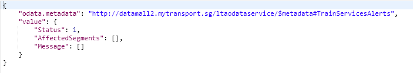

**Sample Scenario #1 - Single Line affected** \
This scenario depicts

- a. NEL – Boon Keng to Dhoby Ghaut, towards Harbourfront station
- b. Free public bus services and free MRT shuttle (towards Harbourfront station)

**Step 1: Activate contingency mode - NEL – Boon Keng to Dhoby Ghaut, towards Harbourfront station**

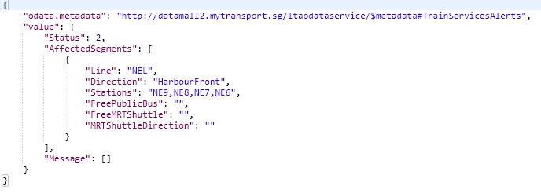

**Step 2: Publish new message**

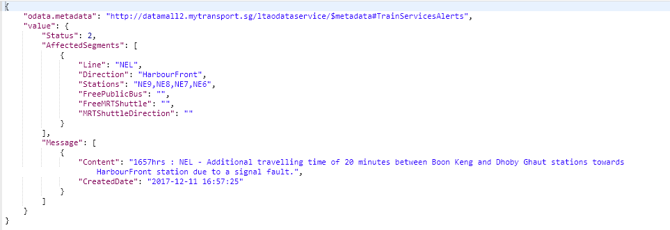

**Step 3: Edit activated contingency mode – Free Public Bus Service and free MRT Shuttle Service (towards HarbourFront)**

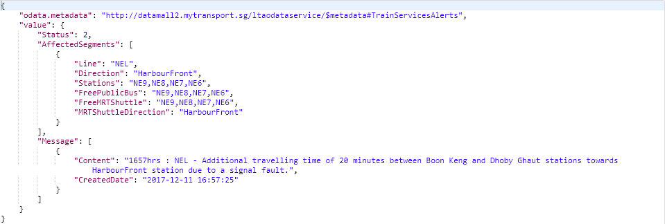

**Step 4: Publish new message**

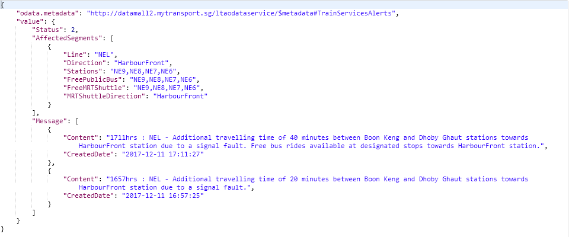

**Step 5: Train service recover with Free Public Bus and MRT shuttle still available**

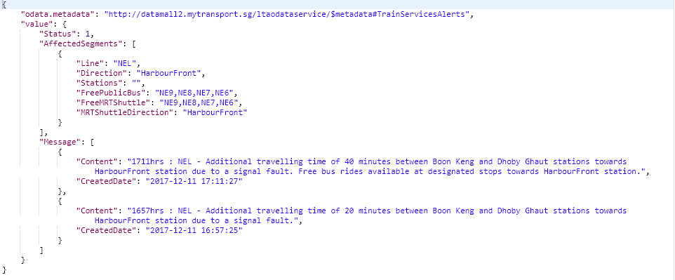

**Step 6: Publish new message**

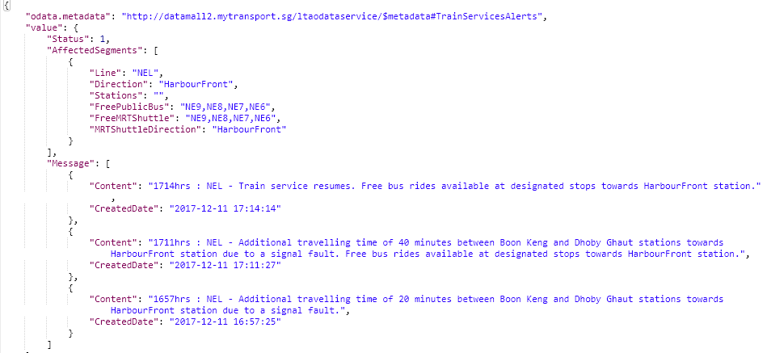

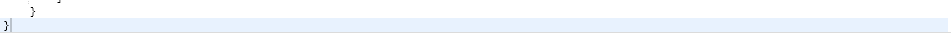

**Step 7: After bus rides are ceased (no new published message)**

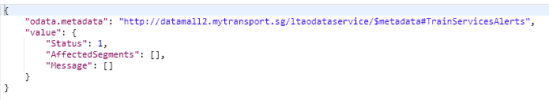

**Sample Scenario #2 - Multi Lines affected** \
This scenario depicts 3 lines: North South Line, East West Line, and Downtown Line are down.

- a. North South Line – between Bishan and Woodlands, towards Jurong East Station
- a. East West Line – between Paya Lebar and Pasir Ris, both direction
- b. MRT Shuttle Services that run along four predefined areas in both directions
- c. Downtown Line – between Downtown and Beauty World, both directions
- d. Free Bus Island-wide

**Step 1: Activate contingency mode – North South Line down with new message published**

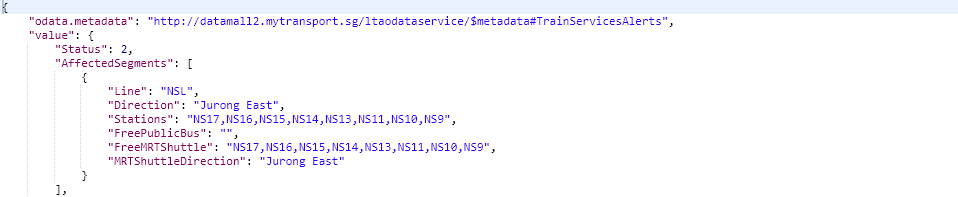


**Step 2: Edit activated contingency mode –East West Line and North South line are down with new message published**

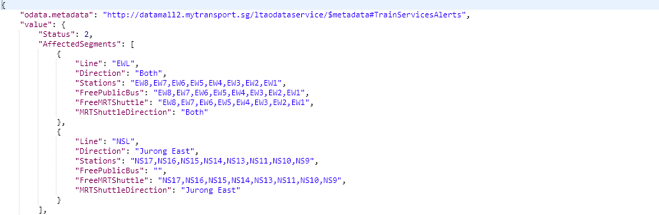

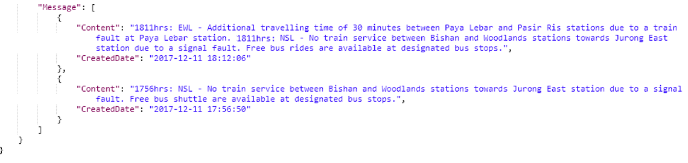

**Step 3: Edit activated contingency mode - Activate MRT shuttle services to run along four predefined areas in both directions (no new message published)**

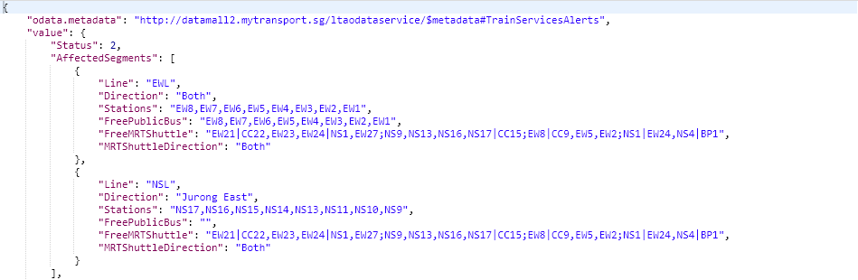


**Step 4: Edit activated contingency mode – In addition to North South, East West lines, Downtown line is also down with new message published**

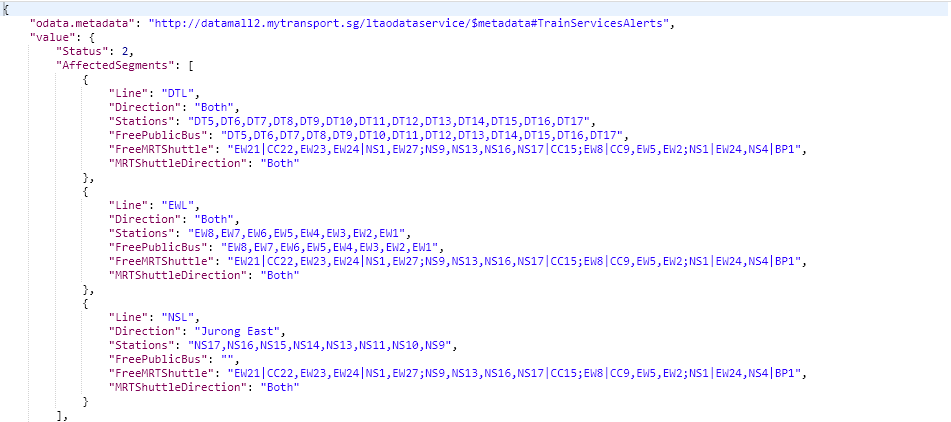

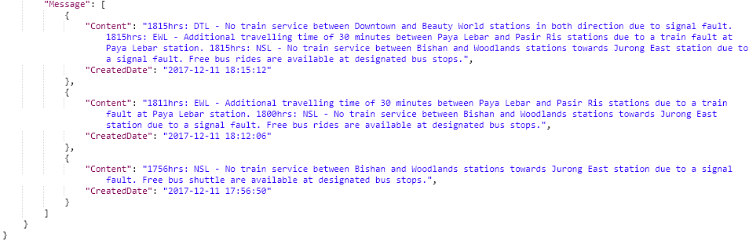

**Step 5: Edit activated contingency mode –Activate Free bus service island-wide with new message published**

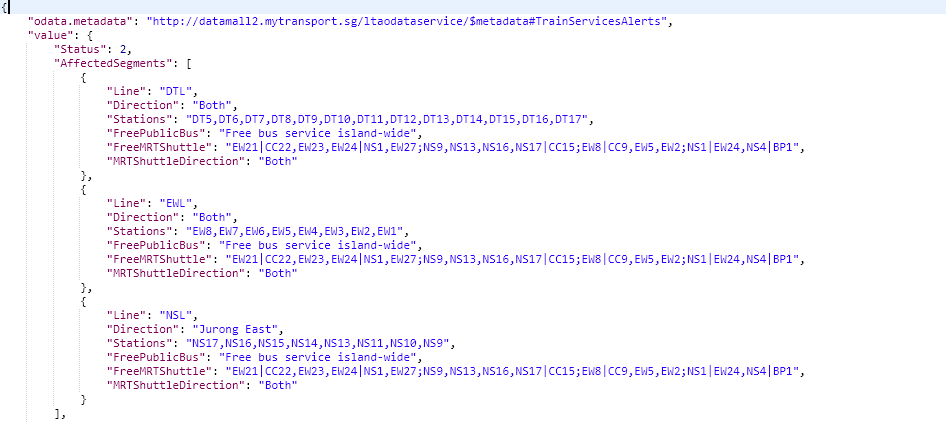

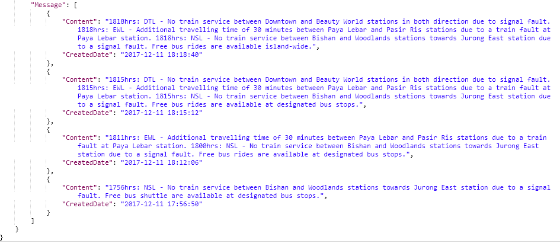

**Step 6: Train service recover – North South and East West line recover with new message published**

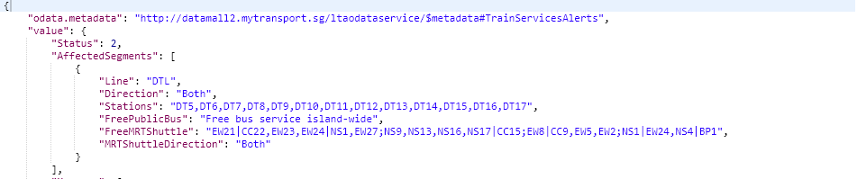

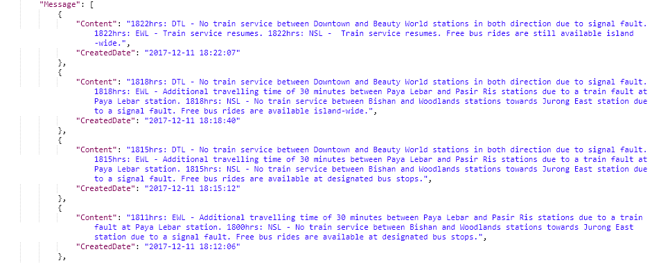

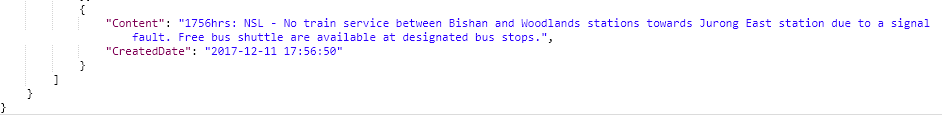

**Step 7: Train service recover – Downtown line recovers, free public bus service and MRT shuttle are still available with new message published**

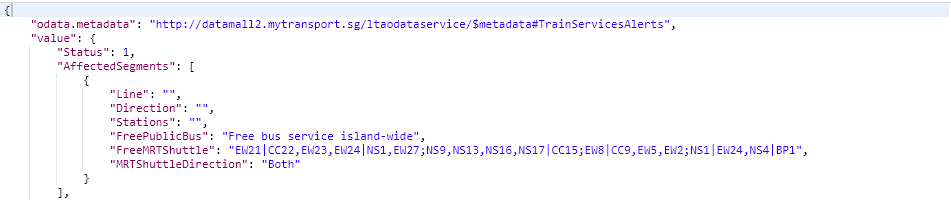


**Step 8: Train service recover – Free public bus service and MRT shuttle have ceased**

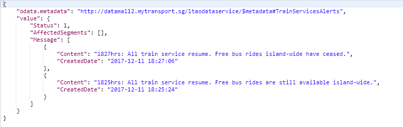

**Step 9: Train service recover - After message has expired**

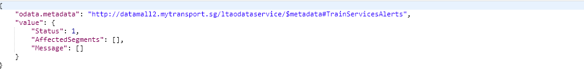

**2.2 Train Delay** \
This scenario depicts there is a delay at Seng Kang West LRT (West Loop).

**Step 1: New message published (Contingency mode is not activated)**

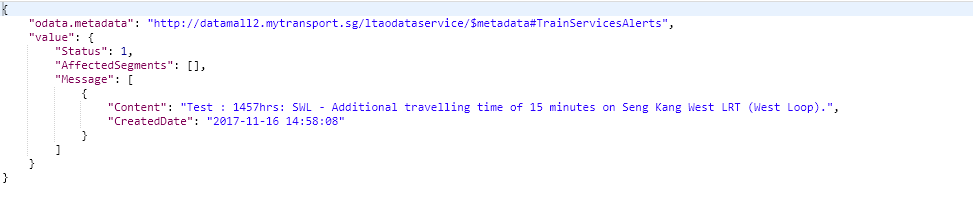

**Step 2: Train Service Resumes**

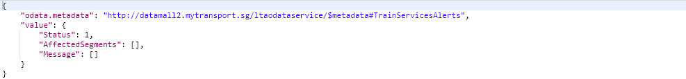

### ANNEX D

**ZONE ID ATTRIBUTE TO SPECIFIC ERP GANTRY/GANTRIES FOR ERP RATES**

| **Zone ID** | **ERP Gantry No.** | **ERP Gantry Location** |
|---|---|---|
| BMC | 1 | Victoria Street |
| BMC | 2 | Nicoll Highway |
| CBD | 3 | Eu Tong Sen Street |
| OC1 | 4 | Orchard Link |
| CBD | 5 | Lim Teck Kim Road |
| CBD | 6 | Anson Road |
| CBD | 7 | Tanjong Pagar Road |
| BMC | 9 | Bencoolen Street |
| BMC | 10 | Queen Street |
| BMC | 11 | North Bridge Road |
| OC1 | 12 | Oxley Road |
| OC1 | 13 | Orchard Road |
| OC1 | 14 | Orchard Turn |
| OC1 | 15 | Killiney Road |
| BMC | 16 | Beach Road |
| BMC | 17 | Temasek Boulevard |
| BMC | 18 | Republic Boulevard |
| CBD | 19 | Havelock Road/Clemenceau Ave |
| CBD | 20 | Havelock Road/CTE Exit |
| OC1 | 21 | Buyong Road |
| OC1 | 22 | Kramat Road |
| BMC | 23 | River Valley Road |
| CBD | 24 | Merchant Road/Clemenceau Ave |
| CBD | 25 | Merchant Road/CTE Exit |
| OC1 | 26 | Clemenceau Ave |
| OC1 | 27 | Cairnhill Road |
| CBD | 28 | Central Boulevard |
| CBD | 29 | Slip Road from Westbound MCE towards Maxwell Road |
| EC1 | 30 | ECP to City |
| CT1 | 31 | CTE after Braddell Road |
| PE1 | 32 | PIE after Kallang Bahru on Woodsville Flyover |
| CT1 | 33 | CTE from Serangoon Road |
| CT1 | 34 | CTE from Balestier Road |
| CT4 | 35 | CTE before Braddell Road |
| AY1 | 36 | AYE to City before Alexandra Road |
| PE2 | 37 | PIE to Changi after Adam Road Exit |
| PE2 | 38 | PIE to Changi / Whitley Road |
| THM | 39 | Thomson Road after Toa Payoh Rise |
| OR1 | 40 | Bendemeer Road |
| AYT | 41 | AYE to Tuas Before Clementi Road |
| PE3 | 42 | PIE into CTE |
| DZ1 | 43 | Dunearn Road / Wayang Satu Flyover |
| DZ1 | 44 | Dunearn Road / Whitley Road |
| PE1 | 45 | PIE slip road to Bendemeer Road |
| CT5 | 46 | CTE Northbound after PIE |
| OC2 | 47 | Orchard Road after YMCA |
| OC3 | 48 | Orchard Road after Handy Road |
| OC2 | 49 | Fort Canning Tunnel |
| KP2 | 50 | KPE Southbound after Defu Flyover |
| CT6 | 51 | CTE Northbound before exit to PIE |
| AYC | 52 | Clementi Avenue 6 into AYE (City) |
| AYC | 53 | Clementi Avenue 2 into AYE (City) |
| BKE | 54 | Bt Timah Expressway (Sb betw Dairy Farm Rd and PIE) |
| UBT | 55 | Upper Bt Timah Rd Southbound after Hume Ave |
| TPZ | 56 | Toa Payoh Lorong 6 |
| KBZ | 57 | Kallang Bahru |
| GBZ | 58 | Geylang Bahru |
| BKZ | 59 | Upper Boon Keng Road |
| SR2 | 60 | Eu Tong Sen Street at Central |
| SR1 | 61 | New Bridge Road before Upper Circular Road |
| SR1 | 62 | South Bridge Road before Upper Circular Road |
| SR2 | 63 | Fullerton Road eastbound at Fullerton Hotel |
| SR1 | 64 | Fullerton Road westbound at One Fullerton |
| PE4 | 65 | PIE westbound before Eunos Link |
| SR2 | 66 | Bayfront Avenue towards Raffles Avenue |
| CT5 | 67 | PIE to CTE Northbound before Braddell Road |
| CT2 | 68 | CTE slip road to PIE (Changi) / Serangoon Road |
| SR1 | 69 | Bayfront Avenue Towards Marina Boulevard |
| KAL | 70 | Geylang Road |
| OR1 | 71 | Woodsville Tunnel |
| CBD | 72 | Sheares Avenue towards Sheares Link |
| EC3 | 73 | ECP eastbound before exit to KPE |
| AYC | 74 | AYE to City Before Clementi Avenue 6 |
| KP1 | 80 | KPE Southbound exit to ECP (City) |
| MC1 | 90 | MCE westbound exit to Marina Coastal Drive |
| MC1 | 91 | MCE westbound before exit to Maxwell Road |
| MC2 | 92 | Marina Boulevard to MCE eastbound |
| MC2 | 93 | MCE eastbound before exit to Central Boulevard |

### ANNEX E

**GEOSPATIAL WHOLE ISLAND LAYER ID FOR 2.22 GEOSPATIAL WHOLE ISLAND**

|  | **S/No Geospatial Whole Island Layers** | **ID** |
|---|---|---|
| 1. | Arrow Marking | ArrowMarking |
| 2. | Bollard | Bollard |
| 3. | Bus Stop Location | BusStopLocation |
| 4. | Control Box | ControlBox |
| 5. | Convex Mirror | ConvexMirror |
| 6. | Covered Link Way | CoveredLinkWay |
| 7. | Cycling Path | CyclingPath |
| 8. | Detector Loop | DetectorLoop |
| 9. | ERP Gantry | ERPGantry |
| 10. | Footpath | Footpath |
| 11. | Guard Rail | GuardRail |
| 12. | Kerb Line | KerbLine |
| 13. | Lamp Post | LampPost |
| 14. | Lane Marking | LaneMarking |
| 15. | Parking Standards Zone | ParkingStandardsZone |
| 16. | Passenger Pickup Bay | PassengerPickupBay |
| 17. | Pedestrain Overheadbridge / Underpass | PedestrainOverheadbridge\_UnderPass |
| 18. | Rail Construction | RailConstruction |
| 19. | Railing | Railing |
| 20. | Retaining Wall | RetainingWall |
| 21. | Road Crossing | RoadCrossing |
| 22. | Road Hump | RoadHump |
| 23. | Road Section Line | RoadSectionLine |
| 24. | School Zone | SchoolZone |
| 25. | Silver Zone | SilverZone |
| 26. | Speed Regulating Strip | SpeedRegulatingStrip |
| 27. | Street Paint | StreetPaint |
| 28. | Taxi Stand | TaxiStand |
| 29. | Traffic Light | TrafficLight |
| 30. | Traffic Sign | TrafficSign |
| 31. | Train Station | TrainStation |
| 32. | Train Station Exit | TrainStationExit |
| 33. | Vehicular Bridge / Flyover / Underpass | VehicularBridge\_Flyover\_Underpass |
| 34. | Word Marking | WordMarking |

### ANNEX F

**DESCRIPTION OF ROAD CATEGORIES FOR 2.26 TRAFFIC FLOW**

|  | **S/No Road Category** | **Description** |
|---|---|---|
| 1. | CAT1 | Expressways <br>Form the primary network where all long-distance traffic movements should be directed. It is planned to optimise long distance mobility from one part of the island to another |
| 2. | CAT2 | Major Arterials <br>Predominantly carry through traffic from one region to another, forming principal avenues of communication for urban traffic movements. It interconnects expressways and minor arterial as well as with other major arterial roads |
| 3. | CAT3 | Minor Arterials <br>Distribute traffic within the major residential and industrial areas. It is planned to optimise circulation within the area and facilitate through traffic between adjacent towns |
| 4. | CAT4 | Primary Accesses <br>Form the link between local accesses and arterial roads. It provides access to developments and through traffic is discouraged. However, where a development is also accessible by a local access road, the access shall be located at the local access road |
| 5. | CAT5 | Local Accesses <br>Give direct access to buildings and other developments and should connect only with primary access |
| 6. | SLIP\_ROAD | Slip Roads <br>Connect roads to allow motorists to change roads without entering an intersection |

### ANNEX G

**LOCATION DESCRIPTION OF CAMERA ID FOR 2.17 TRAFFIC IMAGES**

| **Camera ID** | **Location Description** |
|---|---|
| 2701 | Woodlands Causeway (Towards Johor) |
| 2702 | Woodlands Checkpoint |
| 2704 | BKE (Woodlands Checkpoint) - Woodlands F/O |
| 4703 | Tuas Second Link |
| 4712 | AYE(Tuas) - Tuas Ave 8 Exit |
| 4713 | Tuas Checkpoint |
| 4798 | Sentosa Tower 1 |
| 4799 | Sentosa Tower 2 |
